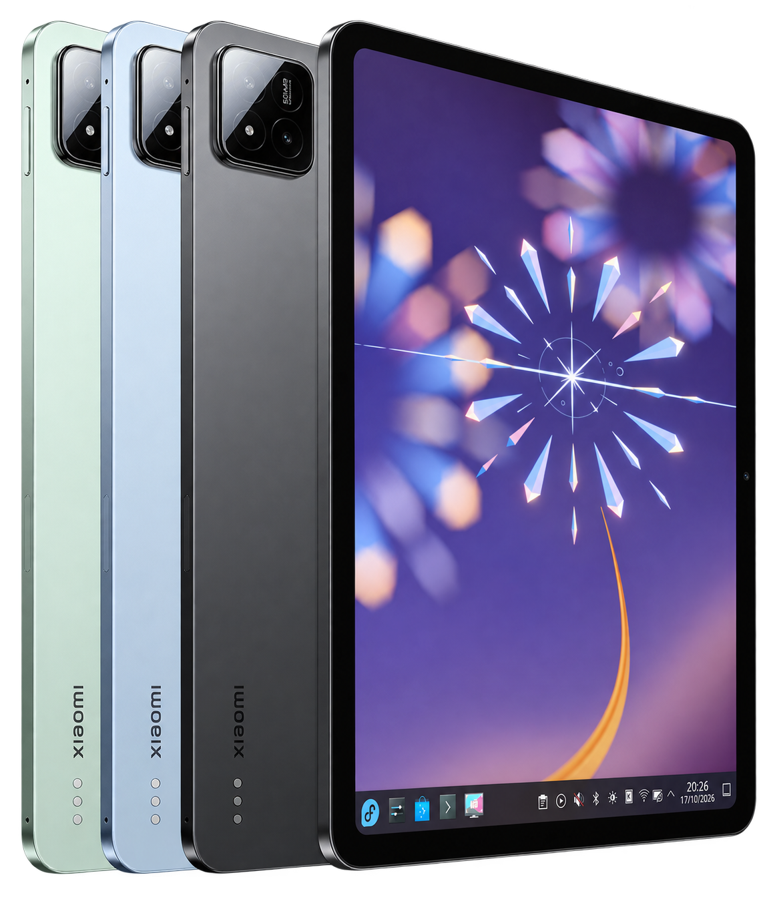
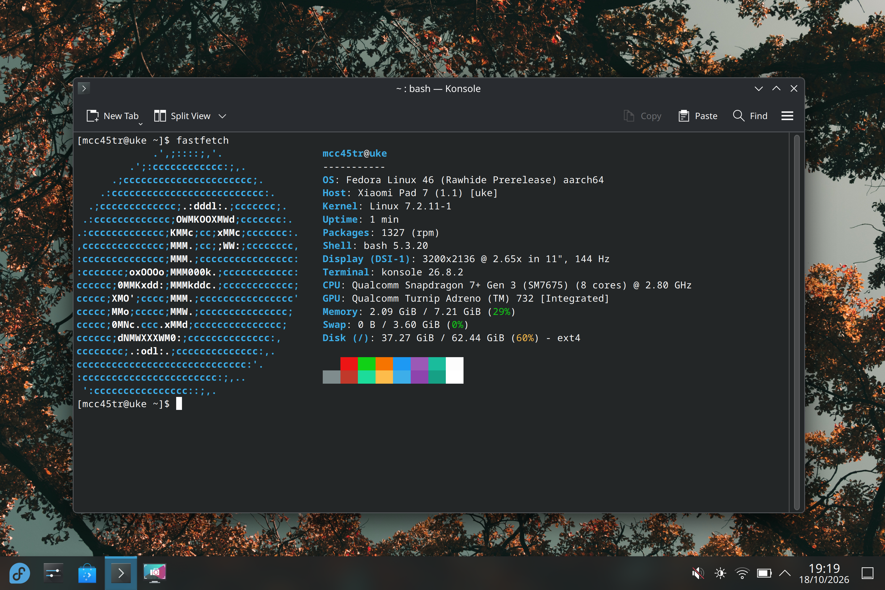

<table>
<tr>
<td width="65%" valign="top">
<h1>Uke Linux</h1>

<strong>Fedora Rawhide for Xiaomi Pad 7 and POCO Pad X1</strong>

A community Linux port for the Snapdragon 7+ Gen 3 (SM7675), with the original Fedora KDE Plasma desktop.

<strong>Experimental alpha</strong> · AArch64 · <code>uke</code>

</td>
<td width="35%" valign="top" align="center">
 

</td>
</tr>
<tr>
<td colspan="2" align="center">

</td>
</tr>
</table>

[Downloads](#downloads) · [Hardware support](#hardware-support) · [18 October changes](CHANGELOG.md) · [Documentation](#documentation) · [Repositories](#project-repositories) · [Report a problem](CONTRIBUTING.md)

> [!WARNING]
> **Not suitable for daily use.** Boot reliability, shutdown, power management
> and several hardware functions remain incomplete. System suspend is disabled.

## Project status

**18 October 2026:** the development installation runs Fedora Rawhide KDE on a
**POCO Pad X1, 8 GB / 512 GB**, using kernel **`7.2.10-29`** and the stock Android
bootloader. Native display output reaches **3200×2136 at 144 Hz**. Xiaomi Pad 7
and other memory/storage variants remain untested.

The hardware results below apply to this separately provisioned development
system. **The public Alpha 1 images use an older kernel and have not been booted
on the tablet as complete exported artifacts.** OEM firmware and device
calibration files are not distributed.

The [18 October development record](CHANGELOG.md) covers the matched kernel,
VRR preference, native management tools, dock mouse, LDAC and battery readback.
Charge-stop and bypass controls are not physically qualified; HDMI tests remain
paused until the requested protection/power-path gate is satisfied.

## Downloads

- **[Fedora Rawhide Alpha 1 — images and checksums](https://github.com/MCC45TR/uke-linux/releases/tag/fedora-rawhide-alpha-1)** — Linux 7.2.9, revision 1.39; predates the current native display and sensor work.
- [Development RPMs on COPR](https://copr.fedorainfracloud.org/coprs/mcc45tr/uke-linux-test/) — kernel and platform packages, with validation recorded per build.
- [Linux image releases](https://github.com/MCC45TR/uke-linux-images/releases) · [Experimental OrangeFox releases](https://github.com/MCC45TR/orangefox_device_xiaomi_uke/releases).

Public installation instructions are pending. Read the release requirements and
verify checksums before using an artifact. **The `userdata` variant replaces
Android user data; it is not a data-preserving dual-boot route.**

## Hardware support

**Validation scope:** POCO Pad X1, 8 GB / 512 GB; Fedora Rawhide AArch64; stock
Android bootloader. The persistent development boot is
`7.2.10-29`, reviewed on 18 October 2026. Earlier subsystem tests
are identified where relevant. These are development-system observations, not acceptance of
the downloadable Alpha 1 images.

<strong>View all hardware support tables</strong>

Each row records the function's current status, observations, and remaining work.

- 🟢 **Working:** the listed function was used successfully on the tested tablet;
  the stated limits still apply.
- 🟡 **Partial:** some functions work, with incomplete integration or validation.
- 🔴 **Broken:** the function is not currently operational in this Linux stack;
  this does not imply a physical hardware defect.
- ⚪ **Not tested:** no functional test result is available.
- ⏸️ **Disabled:** kept off while a known fault is investigated.

### Boot, CPU and storage

| Feature | Status | Validation and remaining work |
|---|---|---|
| Fedora boot | 🟡 **Partial** | Signed COPR 11168479 installs the matched 7.2.10-29 boot B/module bundle through DNF, preserving Android A and the previous 28 tuple. A normal reboot reaches original KDE; the user confirms display and touch. Cold-boot endurance and failure recovery remain open. |
| CPU — Snapdragon 7+ Gen 3 (SM7675) | 🟢 **Working** | All eight cores are online. Heavy workloads have not been tested. |
| CPU frequency control | 🟡 **Partial** | Three policies retain their complete firmware tables and reach 1900.8, 2611.2 and 2803.2 MHz requests under the performance profile. Energy, voltage and sustained throttling behavior remain unqualified. |
| RAM | 🟡 **Partial** | About 7.21 GiB of the installed 8 GB is available. Two 1 GiB memtester trials on 18 October stopped at the test's 65 °C thermal guard before completing. Memory integrity under sustained load and sleep retention remain unqualified. |
| UFS storage | 🟢 **Working** | The internal Fedora root supports reads and writes. Long transfers, power loss and resume have not been tested. |
| Linux partition / EXT4 | 🟡 **Partial** | The 64 GiB root mounts by `PARTLABEL=linux`. Filesystem checks pass after orphan repair; power-loss recovery and complete file integrity still need testing. |
| `reboot bootloader` | 🟡 **Partial** | Reaches fastboot. USB re-enumeration has required physical reconnects. Shutdown reliability remains affected by the KDE clipboard hang. |
| Normal reboot, recovery command and poweroff | 🟡 **Partial** | Normal reboot reaches signed persistent 7.2.10-29. Earlier poweroff stays off without USB; USB-powered poweroff can restart the system. Intermittent full shutdown can hang in KDE. Recovery entry is unqualified. |
| Project Aloha / UEFI boot | ⚪ **Not tested** | The Uke UEFI port is in development. Current Fedora tests use the Android bootloader. |

### Display, graphics and input

| Feature | Status | Validation and remaining work |
|---|---|---|
| Tablet screen / local TTY | 🟢 **Working** | A local console and KDE desktop are visible at 3200×2136. The 17 October native-display boot uses MSM DRM scanout. |
| Manual backlight brightness | 🟢 **Working** | Smooth adjustment was confirmed on 17 October. Both banks use the exact OEM normal-mode mapping through the standard non-linear backlight interface. Active zero requests retain a visible minimum. Optical calibration and automatic control are separate. |
| Screen-off backlight / DPMS | 🟡 **Partial** | Ten cycles on 7.2.10-29 switch the backlight and active CRTC off/on, retaining the touch service and KDE VRR preference. The tenth off transition logs a DPU frame-done timeout. Display lifecycle reliability and system suspend remain unqualified. |
| Native DPU / DSI / DSC display | 🟢 **Working** | The persistent development bundle displays KDE through DSI-1 and msm-kmsdrmfb. The earlier seven-rate transition tests remain bounded; long-run and suspend tests remain open. |
| Refresh-rate switching | 🟢 **Working** | KDE exposes 30/48/50/60/90/120/144 Hz. Nine measured transitions passed on 17 October without panel reset, visible blanking or interrupted touch. Long-run and suspend tests remain open. |
| Adaptive sync / dynamic refresh | 🟢 **Working — development profile** | The user accepts the tested VRR/touch profile. Bounded tests show variable host-interface timing with 30–144 fps delivery, irregular intervals and floor repeats. On 29, KDE Always survives normal reboot without restoration; an eight-second DRM/DPU capture measures about 30 Hz idle with the 144 Hz upper mode selected. Optical panel cadence, complete receiver range and endurance remain unqualified. |
| Display color depth | 🟡 **Partial** | The active desktop uses a 10-bit framebuffer and the exact OEM 10-bpc RGB/DSC link. Xiaomi advertises 12-bit color; native panel depth versus FRC is not independently established. Selectable 8/12/16-bpc link modes are not implemented. |
| Firmware DRM fallback | 🟡 **Partial** | Revision 1.39 uses simpledrm and the bootloader framebuffer. This older path remains separate from the native-display development track. |
| Original Fedora KDE / Wayland | 🟡 **Partial** | Original Fedora applications run on native scanout. A full-shutdown dump identifies a Wayland clipboard deadlock in KGuiAddons 6.31.0; an original distribution fix and repeat tests are required. |
| Manual display rotation | 🟢 **Working** | KScreen manual rotation works. Automatic four-pose rotation and matching touch coordinates also pass direct user checks. |
| GPU — Adreno 732 | 🟡 **Partial — experimental** | Desktop OpenGL validation and a 9,000-frame Vulkan run pass on 29. OpenGL ES has six glmark2 output-validation failures with Mesa 26.2.4. Nine 255–950 MHz states are exposed; profiles change limits. Sustained workloads, thermal actions and suspend remain unqualified. |
| Xwayland / OpenGL | 🟢 **Working — desktop OpenGL** | On 18 October, FD732 hardware rendering passes 27 glmark2 output checks each through Xwayland and Wayland, plus texture, Phong shading and desktop-blur workloads. Six other scenes lack a validation result. Broader applications, OpenGL ES and suspend remain unqualified. |
| Vulkan / Turnip | 🟡 **Partial — experimental** | On 29, Turnip completes 9,000 Wayland frames with exit 0. vulkaninfo exits 1 while querying VK_KHR_display, including with only the Freedreno driver selected. Conformance, long workloads and lifecycle tests remain open. |
| Touchscreen — Novatek NT36532 | 🟢 **Working** | Single-finger input and multitouch remain usable across all seven refresh rates, confirmed on 17 October. Ten simultaneous contacts worked in the 14 October test. Input starts automatically; suspend/resume remains to be validated. Stylus support is listed separately. |
| Stylus / pen | 🔴 **Broken** | Pen input, pressure and tilt are unavailable. |
| Power / volume buttons | 🟢 **Working** | All power and volume buttons work during normal Fedora use, confirmed on 14 and 17 October. Wake from actual suspend is listed separately. |
| Power-button screen toggle | 🟡 **Partial — configured** | Original PowerDevil is configured for display-only on/off. Physical power-button toggle validation remains pending; this is separate from s2idle. |
| USB keyboard / mouse | 🟡 **Partial — mouse tested** | With the powered Juo dock on kernel 27, the receiver enumerates, evdev records mouse movement and the user confirms pointer operation. Keyboard, reconnect and suspend coverage remain open. |
| Pogo keyboard / touchpad | ⚪ **Not tested** | No pogo keyboard is available. The OEM Nanosic transport and MiAuth authentication still need a native Linux implementation. The Android [keyboard fix](https://github.com/JohnnyFFM/xiaomi-keyboard-fix/tree/f838a54bd70f84087cd35b54d5d62c7bba489d15) is a protocol reference. No keyboard light control is exposed without hardware. |

### Networking and USB

| Feature | Status | Validation and remaining work |
|---|---|---|
| Wi-Fi — WCN6750 | 🟢 **Working** | Automatic connection, SSH, DNS and a verified 16 MiB transfer work. The protected factory-data reader supplies the device's own WLAN address across restarts. Broader cold-boot and resume testing remains open. |
| Signed network updates | 🟢 **Working** | Fedora and COPR packages install over Wi-Fi with signature checks. Kernel and boot-image updates require matching files. |
| Bluetooth | 🟢 **Working — mouse and audio** | The controller starts automatically. A Bluetooth 5.2 mouse pairs and reconnects with movement, clicks and wheel input. A soundcore Space Q45 also plays stereo audio over LDAC. Broader device and lifecycle coverage remains untested. |
| NFC | ⚪ **Not tested** | No controller is exposed. A fitted NFC chip has not been confirmed. |
| USB overall | 🟡 **Partial** | Kernel 27 supports a powered Juo dock and mouse while reporting host data and sink power roles. Device-mode results are separate. HDMI, storage, networking, all role combinations and lifecycle endurance remain open. |
| USB CDC ACM / serial shell | 🟡 **Partial — manual** | CDC defaults off. Explicit one-shot management uses uke-control set cdc on/off, without a persistent gadget service. Earlier bidirectional development commands pass; matched-profile PC reconnect, suspend and role-change coverage remain open. |
| USB ECM / SSH | 🟢 **Working — manual** | SSH and a verified 16 MiB transfer worked in earlier tests. USB networking is now off by default; development uses Wi-Fi. |
| USB host / accessory power (VBUS) | 🟡 **Partial** | Powered-dock HID operation passes on 27; an unpowered dock enumerates on 28. The earlier ESP32-S3 power failure is not retested. Available VBUS budget, overcurrent behavior and broader accessories remain unqualified. |
| USB-C switch / role control | 🟡 **Partial** | The switch driver starts and device mode works. Data-role and source/sink power-role selection are not yet correct across connections; role changes and accessory power need work. |
| USB reconnect / driver lifecycle | 🟡 **Partial** | Software reconnect worked. A live battery-driver reload caused a USB fault; the correction and physical cable reconnect still need testing. |
| USB SuperSpeed | 🟡 **Partial — enumeration** | Juo hubs and RTL8153 enumerate at 5 Gbit/s in bounded trials. USB 3 storage transfers and throughput remain untested. |
| DisplayPort / USB-C video output | 🟡 **Partial** | The connector and notification path exist; 28 fixes a traced type-2 notification rejection. No successful tablet HDMI output yet. The Juo dock requires PD power on the tested laptop; an unpowered trial is inconclusive. |
| External-monitor DDC/CI brightness | 🟡 **Partial — desktop initialization** | Original Fedora ddcutil is installed. Adaptive-display 9 retains successful original PowerDevil/libddcutil initialization after reboot, excluding internal GENI buses. Actual HDMI output and monitor brightness control remain untested. |
| USB Ethernet adapters / hubs | 🟡 **Partial** | Juo USB 2/3 hubs, HID and RTL8153 enumerate. On 28, ethtool reports rtl8153b-2 v2 04/27/23 after the compressed-firmware fix. Ethernet carrier is zero; no cable or traffic acceptance. |

### Sensors and desktop integration

The persistent development boot starts SSC and SensorProxy through native readiness
dependencies. Original KDE consumes their standard D-Bus interfaces. Factory
registry and calibration data stay on read-only `persist`; runtime registry
writes use a RAM copy. Not every discovered endpoint has a qualified Linux
event mapping or physical calibration result.

| Feature | Status | Validation and remaining work |
|---|---|---|
| Sensor DSP / SSC discovery | 🟡 **Partial** | Native registry/cache and FastRPC dependencies start automatically. Motion, light, compass and proximity interfaces appear after persistent boot. DSP restart recovery and remaining endpoint mappings are incomplete. |
| Accelerometer — LSM6DSO | 🟢 **Working — rotation** | Four physical poses and touch alignment pass user checks after the orientation correction; the function survives normal persistent boot. Factory registry data is read from read-only persist. Absolute calibration accuracy remains unqualified. |
| Gyroscope — LSM6DSO | 🟡 **Partial** | Finite XYZ angular-velocity samples are available in radians per second. Drift and dynamic accuracy remain unqualified. |
| Magnetometer / compass — QMC630x family | 🟡 **Partial** | SensorProxy returns finite headings that change through physical motion. Absolute heading accuracy is not established; the phone comparison does not pass. Factory calibration remains read-only. |
| Front light sensor — STK3BCx family | 🟢 **Working — ambient light** | Front lux responds to illumination and participates in dual-sensor KDE brightness. Vendor raw channels are retained without invented units; spectral accuracy remains unqualified. |
| Rear light sensor — SIP1328 | 🟢 **Working — ambient light** | Rear-only illumination changes KDE backlight while the front stays dark. Lux response is measured; raw spectral channels and flicker require separate qualification. |
| Ambient color temperature | ⚪ **Not qualified** | A native development diagnostic exists, but the optional front-color endpoint has no valid startup sample. Kelvin conversion and spectral calibration remain unqualified. |
| Front proximity sensor — STK3BCx family | 🟢 **Working — near/far** | Physical open, covered and released trials report far → near → far through standard SensorProxy. Automatic desktop actions and longer lifecycle tests remain unqualified. |
| SAR / body proximity — SX937x family | ⏸️ **Disabled** | Three authorized SAR lookups return no endpoint; no sample vector or physical response is established. It remains disabled. |
| Automatic rotation / sensor fusion | 🟢 **Working — four poses** | Original KDE rotates correctly in all four poses with matching touch coordinates. Normal persistent boot restores the feature. |
| Automatic brightness | 🟡 **Partial** | Original KDE exposes and enables automatic brightness using jointly processed front/rear light and an OEM-derived curve. Dark/front/rear transitions and normal persistent startup pass. A 45-second white / 45-second black trial stays at 22/2047 without runaway. Long-run and sunlight tests remain open. |
| Magnetic cover / lid detection | 🟡 **Partial — input events** | On 7.2.10-8, the Hall module and both input nodes appear automatically. Front close/open and rear fold/unfold generate standard switch events; logind tracks the lid. Cover-triggered display blanking and closed-cover boot remain unqualified. |
| Temperature sensors | 🟡 **Partial** | On 7.2.10-8, 69 hwmon temperature inputs and 51 thermal zones are readable. All 27 PMIC channels expose 17 temperatures, eight voltages and two currents through standard interfaces and KDE. Counts overlap. Internal CHG_TEMP reads 31.29–31.41 °C with USB power; its inactive near-zero input is OEM-clamped to 0 °C without USB power. Conversion checks pass; absolute calibration and complete thermal policy remain unqualified. |

### Audio, cameras and media

| Feature | Status | Validation and remaining work |
|---|---|---|
| Internal speakers | 🔴 **Broken** | No usable ALSA playback route. |
| Microphones | 🔴 **Broken** | No usable ALSA recording route. |
| Bluetooth audio / LDAC | 🟢 **Working — stereo playback** | On 18 October, soundcore Space Q45 playback is reported clear and PipeWire confirms a running A2DP sink with the LDAC codec. Microphone/HFP, latency, reconnection and suspend behavior remain untested. |
| USB audio | ⚪ **Not tested** | No USB playback or recording acceptance. |
| Front camera | ⚪ **Not tested** | On 29, no video device or media graph is exposed; the bounded V4L2 capture attempt cannot open a device. No verified front-camera frame. |
| Rear camera | ⚪ **Not tested** | On 29, no video device or media graph is exposed. No verified rear-camera pipeline or frame. |
| Hardware video decoding / encoding | ⚪ **Not tested** | On 29, no V4L2 codec device or GStreamer hardware codec factory is available for a workload. Hardware decoding and encoding remain unverified. |

### Power, thermal management and platform services

| Feature | Status | Validation and remaining work |
|---|---|---|
| Battery percentage / voltage / temperature | 🟡 **Partial** | Readings start automatically on normal slot-B boots. Long-term accuracy and all battery states still need testing. |
| Battery current / power / charging indication | 🟡 **Partial** | Signed current, derived voltage×current power and charge-counter readings reach standard power-supply/hwmon interfaces. External power can be present while the battery discharges; a Charging flag alone does not prove energy gain. |
| Charging from computer USB | 🟡 **Partial** | Revision 1.39 automatically admits the enumerated 500 mA budget; measured input is about 450 mA. Active-system load can exceed this supply, and a three-minute native diagnostic trial lost battery charge. Sustained net charging remains unqualified. |
| USB Power Delivery / fast charging | 🟡 **Partial — powered dock** | The Ricomm-powered Juo dock supplies charging while the tablet uses host data role. Bounded battery readings are available; exact negotiated contracts, all charging protocols and protection behavior remain unqualified. |
| Charge limits / charge stop | 🟡 **Partial — firmware readback** | On 29, the deliberate root query reads restart 70%, stop 80% and feature disabled with USB input off. General controls remain unqualified. No SET, physical 80% hold, termination or reboot-persistent cap is accepted. Full SOC with Charging alone establishes neither cutoff nor a fault. |
| Battery bypass / direct system supply | ⚪ **Not qualified** | No verified bypass control or battery-isolation result. A charge threshold is not a bypass. Powered HDMI tests remain paused for the requested protection/power-path work. |
| Native device management | 🟡 **Partial** | Signed COPR 11168593 installs C++ uke-control 11 and separate development diagnostics; COPR 11168630 supplies runtime/helper 6. The observer distinguishes the VRR upper limit from measured DPU cadence. Half-RAM swap survives normal reboot. Explicit threshold GETs work; the restricted cap-enable request refuses the missing kernel-29 interface. Charging actuation and existing swap-partition preference remain untested. |
| Offline charging screen | ⚪ **Not tested — package installed** | Signed COPR 11168630 installs a separate minimal native DRM interface with a large battery, percentage, firmware time-to-full, battery-side watts and temperature. Normal-boot refusal passes without interrupting KDE/touch. The matched initramfs handoff targets 7.2.11; actual charger boot, screen/key/unplug behavior, low battery and power use remain unqualified. |
| Plasma battery indicator | 🟡 **Partial** | The battery icon and readings were observed through UPower. Startup and current/counter interpretation still need work. |
| Desktop power profiles | 🟡 **Partial** | On 29, all three PPD selections match CPU governors and GPU limits; balanced is restored afterward. Sustained energy, responsiveness and complete OEM thermal policy remain unqualified. |
| Thermal protection / throttling | 🟡 **Partial** | Software-emulated thermal events lower three CPU policy limits and the GPU limit; PPD respects thermal QoS. All emulation values are cleared afterward. Actual heat, sustained throttling, protective shutdown and full OEM BCL/skin policy remain unqualified. |
| Display-only soft sleep | 🟡 **Partial** | Ten display-only off/on cycles on 29 restore backlight and scanout state, but one DPU frame-done timeout remains. System sleep and physical wake are untested. |
| Suspend-to-idle / s2idle | ⏸️ **Disabled** | Sleep remains disabled. The brief black-screen interval did not confirm suspend entry. |
| Deep suspend | ⚪ **Not tested** | Advertised by the kernel; actual sleep and resume have not been verified. |
| Power-key IRQ wake | ⚪ **Not tested** | The input and wake flag exist. Wake from actual sleep has not been tested. |
| USB cable wake | 🔴 **Broken** | Required USB wake interrupts are missing from the current device tree. |
| USB keyboard / mouse wake | ⚪ **Not tested** | Host mouse operation is established separately; wake from actual sleep remains untested. |
| RTC / persistent clock | 🟡 **Partial** | The raw RTC reports an incorrect startup time. Original chronyd restores its saved drift-file time before readiness, then synchronizes over NTP; a fresh boot confirms this behavior. |
| Watchdog | 🟡 **Partial** | The driver starts. Recovery behavior has not been tested. |
| PMIC / regulators | 🟡 **Partial** | Storage and USB have enough working resources. Other PMIC probes still fail. |
| DMA / IOMMU resources | 🟡 **Partial** | Storage, USB and Wi-Fi paths work. GPU and other clients need integration and testing. |
| Interconnect / platform power control | 🟡 **Partial** | Basic root and USB operations work. Provider errors and power/performance behavior remain unresolved. |
| DSPs — ADSP / CDSP / QSH | 🟡 **Partial** | ADSP charger and SSC services start through native resource/readiness dependencies. Audio, other DSPs and restart reliability remain incomplete. SLIMbus and automatic DSP recovery stay disabled. |
| FastRPC | 🟡 **Partial** | Two admitted ADSP contexts serve the sensor registry after persistent boot. General DSP compute and recovery remain unqualified. |
| CoreSight tracing | ⏸️ **Disabled** | Autoload is blocked after earlier resets. The cause still needs investigation. |

The current boot handoff is **EL1**. EL2/KVM work remains on a separate
experimental branch, and Project Aloha/UEFI is not the boot path used for the
reported Fedora tests.

## Documentation

| Topic | Guide |
|---|---|
| Build Fedora images | [Image recipes and validation](https://github.com/MCC45TR/uke-fedora-builder/blob/main/docs/IMAGES.md) |
| Build the kernel | [Kernel build automation](https://github.com/MCC45TR/senemos-uke-kernel-mainline/blob/main/docs/AUTOMATION.md) |
| Boot requirements and rollback | [Stock-bootloader boot pair](https://github.com/MCC45TR/uke-linux-docs/blob/main/docs/testing/FEDORA-BOOT-PAIR.md) — private, access required |
| Development plan | [Milestones and remaining work](https://github.com/MCC45TR/uke-linux-docs/blob/main/PLAN.md) — private, access required |
| Engineering records | [Documentation index](https://github.com/MCC45TR/uke-linux-docs/blob/main/docs/README.md) — private, access required |
| Desktop screenshots | [Fedora KDE gallery](assets/screenshots) |
| Contributing and bug reports | [Reporting guide](CONTRIBUTING.md) · [Open an issue](https://github.com/MCC45TR/uke-linux/issues/new?template=bug_report.yml) |
| Security reports | [Security policy](SECURITY.md) |

## Project repositories

| Component | Repository |
|---|---|
| Kernel and device trees | [senemos-uke-kernel-mainline](https://github.com/MCC45TR/senemos-uke-kernel-mainline) |
| Hardware integration and packages | [uke-linux-hardware-support](https://github.com/MCC45TR/uke-linux-hardware-support) |
| Fedora image builder | [uke-fedora-builder](https://github.com/MCC45TR/uke-fedora-builder) |
| Image distribution | [uke-linux-images](https://github.com/MCC45TR/uke-linux-images) |
| OrangeFox Recovery | [orangefox_device_xiaomi_uke](https://github.com/MCC45TR/orangefox_device_xiaomi_uke) |
| Experimental UEFI | [uke-project-aloha](https://github.com/MCC45TR/uke-project-aloha) |

## License

Original files use the [MIT License](LICENSE). Components retain their own
licenses and attribution. Uke Linux is an independent community project,
unaffiliated with Fedora, Xiaomi, POCO or Qualcomm.
