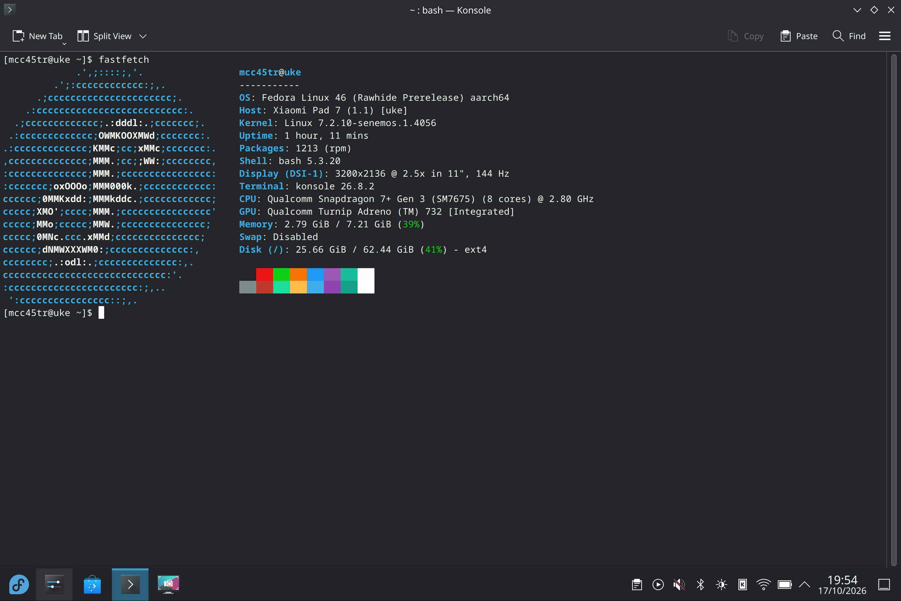

<div align="center">

# Uke Linux

**Fedora Rawhide for Xiaomi Pad 7 and POCO Pad X1**

A community Linux port for the `uke` platform, with native display support,
device integration, and a shared kernel and image-building workspace.

[](#project-status)


**Snapdragon 7+ Gen 3 · SM7675 · `uke`**

[Project status](#project-status) · [Downloads](#downloads) · [Hardware support](#hardware-support) · [Roadmap](#development-roadmap)

[Repositories](#project-repositories) · [Build and validate](#building-and-validation) · [Contribute](#contributing-and-reporting-issues)

</div>

> [!WARNING]
> **Experimental alpha — not suitable for daily use.** Boot reliability,
> display artifacts, power management, and several hardware functions remain
> unresolved. The downloadable release and the tested development installation
> have different validation histories; see [release and validation tracks](#release-and-validation-tracks).



*Fedora KDE at 3200×2136 and 144 Hz on the development installation,
17 October 2026. This screenshot does not describe the downloadable Alpha 1 images.*

## Project status

**Last reviewed: 18 October 2026.** The tested device is a **POCO Pad X1,
8 GB RAM / 512 GB storage**, running Fedora Rawhide AArch64 through the stock
Android bootloader. Linux reports the model as Xiaomi Pad 7. Other device and
memory/storage variants remain untested.

Uke Linux brings together the Senemos kernel, hardware support packages, Fedora
image recipes, recovery, and experimental UEFI work. This repository is the
project overview and shared workspace; implementation lives in the
[component repositories](#project-repositories).

### Current development result

The installed slot B image running **`7.2.10-8`** reaches the
original Fedora KDE desktop through the **native DPU/DSI display driver at
3200×2136**. Android slot A and the verified `.4054` Linux rollback remain
preserved. This development installation is separate from the public Alpha 1.
Original Fedora Plasma Login Manager 6.8.0 now starts the Wayland session;
SDDM is disabled and retained for rollback.

- **Display and input:** all seven OEM modes are available: 30, 48, 50, 60, 90,
  120 and 144 Hz. Nine earlier transitions retained panel and touch state.
  Four-pose automatic rotation and touch alignment pass direct user checks.
- **Sensors:** front and rear ambient-light readings jointly drive KDE automatic
  brightness through an OEM-derived curve. Dark, front-only and rear-only
  trials change actual backlight values. Rotation and brightness work after a
  normal persistent boot. Factory calibration stays on read-only persist.
- **Connectivity:** Bluetooth starts automatically; a paired Bluetooth 5.2 mouse
  provides movement, clicks and wheel input. Wi-Fi discovers the reported
  network and connects on 5 GHz. No 6 GHz peer or hotspot result is established.
- **Power:** three real CPU/GPU profiles operate through Power Profiles daemon.
  CPU requests reach the firmware maxima, and the GPU retains nine 255–950 MHz
  states. Software-emulated thermal events lower all three CPU policy limits
  and the GPU limit; power profiles respect those caps. Sustained performance,
  energy use and protection under actual heat remain unqualified.
- **Telemetry:** all 27 OEM PMIC ADC channels are exposed through IIO and hwmon.
  Original KDE System Monitor's backend returns live values for all 27 channels
  and battery voltage, signed current and derived power with standard units.
  The complete installation has 69 readable hwmon temperature inputs and 51
  thermal zones; several interfaces represent the same physical measurement.
  Battery power is derived from signed current and voltage. The OEM charger
  temperature channel reads 31.29–31.41 °C with USB power. Without USB power,
  its near-zero ADC input produces the OEM-clamped 0 °C; this is not a measured
  ambient temperature. Independent conversion checks match the live results.
- **Cover sensors:** front close/open and rear fold/unfold generate standard
  kernel switch events. logind tracks the lid; KDE retains tablet mode without
  a keyboard. Automatic cover-triggered display blanking remains unqualified.

Systemd reports 8.663 seconds for the measured system startup with Plasma Login
Manager; desktop readiness is a separate observation. Two preceding normal KDE
reboot cycles reach the reboot target about three seconds after logind's request.
The first release-5 boot followed a forced power cycle. Full shutdown remains unreliable:
an actual plasmashell dump identifies a KDE Wayland clipboard deadlock.
Automatic brightness needs longer feedback/endurance tests. Absolute compass
accuracy, cover display policy, complete PMIC/thermal policy,
audio and USB host roles remain incomplete. Two SPI/GPI timeouts leave long-idle
touchscreen reliability open. A bounded AVR experiment is included, disabled by default;
physical VRR activation tests are assigned to a separate continuation. System suspend
remains disabled. The [hardware tables](#hardware-support) state each test limit.

### Release and validation tracks

| Track | Baseline | What has been established |
|---|---|---|
| **Public Alpha 1** | Linux 7.2.9, revision **1.39** | The exact exported boot variants and root filesystem have **not been booted on the tablet**. They do not include the current native display and sensor work. |
| **Tested development installation** | **`7.2.10-8`** | Signed COPR packages install through DNF and update persistent slot B with verified backup/readback. Normal KDE reboot restores 27 ADC channels, two Hall input nodes, rotation and brightness APIs. Physical lid/fold transitions pass. Original Fedora Plasma Login Manager starts the session. |
| **COPR kernel producer** | **`7.2.10-8`** delivered | [Build 11165188](https://copr.fedorainfracloud.org/coprs/build/11165188) passes signatures, matched Image/module/container checks and bounded tablet sensor tests. The included AVR experiment remains disabled and unqualified. |
| **COPR platform packages** | Original KDE with native hardware integration | Sensor startup, dual-light brightness, Bluetooth mouse and CPU/GPU profiles have bounded tablet results. A successful RPM build alone does not establish hardware support. |

The consolidated kernel source uses integer releases: `7.2.10-1`, `-2`, `-3`;
a separately pinned 7.2.11 starts at `7.2.11-1`. The native updater retains a
verified previous image. The public Alpha 1 release remains unchanged.

> [!IMPORTANT]
> **Hardware status applies to the separately provisioned development system.**
> OEM firmware and device calibration files are not distributed. The public
> image does not include their provisioning workflow, so hardware that depends
> on those files cannot be assumed to work in a downloaded image.

## Downloads

### Fedora Rawhide Alpha 1

**[Open the Alpha 1 release and checksums](https://github.com/MCC45TR/uke-linux/releases/tag/fedora-rawhide-alpha-1)**

| Artifact | Purpose | Root target |
|---|---|---|
| `fedora-rawhide-uke-system-alpha-1.img` | Fedora Rawhide root filesystem | Use only with the corresponding boot image and intended partition layout. |
| `fedora-linux-uke-senemos-729-boot-lp.img` | Boot image for a dedicated Linux partition | `PARTLABEL=linux` |
| `fedora-linux-uke-senemos-729-kernel-up.img` | Experimental boot image for the Android user-data partition; not tested on the tablet | `PARTLABEL=userdata` |

Both public boot variants and the exported root filesystem are untested as
complete tablet boot artifacts. Their baseline is revision 1.39. Earlier Core
and KDE images are also prebuild tests: their exact root filesystems have
host/VM checks but have not been booted on this tablet.

### Installation status

Public installation instructions will follow. The
[build examples](#building-and-validation) cover artifact generation and
inspection; installation requires a separately prepared, appropriate partition
layout and matched boot files.

> [!CAUTION]
> **Using `userdata` for Fedora replaces Android user data.** The `userdata`
> variant is not an Android data-preserving dual-boot route. The preservation
> of Android slot A on the development tablet does not establish a public
> installation workflow for other devices.

Verify the downloaded files against the release checksums and record the exact
filenames before reporting a result. Kernel, modules, DTBs, and boot artifacts
must match. DNF installs packages. On an explicitly configured development system, the
native kernel updater also writes and verifies the matching slot B boot image;
this does not create partitions or select a different slot.

### Other distribution channels

| Channel | Contents |
|---|---|
| [Development RPMs on COPR](https://copr.fedorainfracloud.org/coprs/mcc45tr/uke-linux-test/) | Development kernel and platform packages. Read the validation scope above before selecting a build. |
| [Linux image releases](https://github.com/MCC45TR/uke-linux-images/releases) | Image release assets and checksums. |
| [Experimental recovery releases](https://github.com/MCC45TR/orangefox_device_xiaomi_uke/releases) | OrangeFox recovery artifacts. |

## Hardware support

**Validation scope:** POCO Pad X1, 8 GB / 512 GB; Fedora Rawhide AArch64; stock
Android bootloader. The persistent development boot is
`7.2.10-8`, reviewed on 18 October 2026. Earlier subsystem tests
are identified where relevant. These are development-system observations, not acceptance of
the downloadable Alpha 1 images.

**Expand a category to view its hardware table.** Each row records the
function's current status, observations, and remaining work.

- 🟢 **Working:** the listed function was used successfully on the tested tablet;
  the stated limits still apply.
- 🟡 **Partial:** some functions work, with incomplete integration or validation.
- 🔴 **Broken:** the function is not currently operational in this Linux stack;
  this does not imply a physical hardware defect.
- ⚪ **Not tested:** no functional test result is available.
- ⏸️ **Disabled:** kept off while a known fault is investigated.

<!-- Keep these hardware tables collapsed by default. Preserve the scope and
limitations of individual test results when updating a status. -->

<details>
<summary><strong>Boot, CPU and storage</strong> — 9 items</summary>

| Feature | Status | Validation and remaining work |
|---|---|---|
| Fedora boot | 🟡 **Partial** | The signed COPR 7.2.10-8 slot B bundle reaches native-display KDE. Automatic sensor startup returns after normal persistent boot. Cold-boot endurance and failure recovery remain open. |
| CPU — Snapdragon 7+ Gen 3 (SM7675) | 🟢 **Working** | All eight cores are online. Heavy workloads have not been tested. |
| CPU frequency control | 🟡 **Partial** | Three policies retain their complete firmware tables and reach 1900.8, 2611.2 and 2803.2 MHz requests under the performance profile. Energy, voltage and sustained throttling behavior remain unqualified. |
| RAM | 🟡 **Partial** | About 7.21 GiB of the installed 8 GB is available. Memory stress and sleep retention have not been tested. |
| UFS storage | 🟢 **Working** | The internal Fedora root supports reads and writes. Long transfers, power loss and resume have not been tested. |
| Linux partition / EXT4 | 🟡 **Partial** | The 64 GiB root mounts by `PARTLABEL=linux`. Filesystem checks pass after orphan repair; power-loss recovery and complete file integrity still need testing. |
| `reboot bootloader` | 🟡 **Partial** | Reaches fastboot. USB re-enumeration has required physical reconnects. Shutdown reliability remains affected by the KDE clipboard hang. |
| Normal reboot, recovery command and poweroff | 🟡 **Partial** | Normal KDE reboot reaches the signed persistent 7.2.10-8 bundle. Poweroff stays off without USB; USB-powered poweroff can restart the system. Intermittent full shutdown can hang in KDE. Recovery entry is unqualified. |
| Project Aloha / UEFI boot | ⚪ **Not tested** | The Uke UEFI port is in development. Current Fedora tests use the Android bootloader. |

</details>

<details>
<summary><strong>Display, graphics and input</strong> — 17 items</summary>

| Feature | Status | Validation and remaining work |
|---|---|---|
| Tablet screen / local TTY | 🟢 **Working** | A local console and KDE desktop are visible at 3200×2136. The 17 October native-display boot uses MSM DRM scanout. |
| Manual backlight brightness | 🟢 **Working** | Smooth adjustment was confirmed on 17 October. Both banks use the exact OEM normal-mode mapping through the standard non-linear backlight interface. Active zero requests retain a visible minimum. Optical calibration and automatic control are separate. |
| Screen-off backlight / DPMS | 🟡 **Partial** | Three bounded screen-off/on cycles retain the touch input device. Touch readiness improves from about 1.5 s to 0.65–0.71 s; the user reports normal use. Full suspend remains unqualified. |
| Native DPU / DSI / DSC display | 🟢 **Working** | The persistent development bundle displays KDE through DSI-1 and msm-kmsdrmfb. The earlier seven-rate transition tests remain bounded; long-run and suspend tests remain open. |
| Refresh-rate switching | 🟢 **Working** | KDE exposes 30/48/50/60/90/120/144 Hz. Nine measured transitions passed on 17 October without panel reset, visible blanking or interrupted touch. Long-run and suspend tests remain open. |
| Adaptive sync / dynamic refresh | 🔴 **Broken** | No qualified VRR implementation. Discrete OEM modes do not establish adaptive-sync support. |
| Firmware DRM fallback | 🟡 **Partial** | Revision 1.39 uses simpledrm and the bootloader framebuffer. This older path remains separate from the native-display development track. |
| Original Fedora KDE / Wayland | 🟡 **Partial** | Original Fedora applications run on native scanout. A full-shutdown dump identifies a Wayland clipboard deadlock in KGuiAddons 6.31.0; an original distribution fix and repeat tests are required. |
| Manual display rotation | 🟢 **Working** | KScreen manual rotation works. Automatic four-pose rotation and matching touch coordinates also pass direct user checks. |
| GPU — Adreno 732 | 🟡 **Partial — experimental** | Hardware rendering and bounded OpenGL/Vulkan tests pass. Nine 255–950 MHz states are exposed and residency changes during use. CPU/GPU profiles change limits. Sustained workloads, thermal actions and suspend remain unqualified. |
| Xwayland / OpenGL | 🟡 **Partial — experimental** | A fresh session reports Freedreno and hardware acceleration, with OpenGL 4.6 available. Late GPU loading requires a clean graphical session; broad application testing remains open. |
| Vulkan / Turnip | 🟡 **Partial — experimental** | A bounded Wayland cube completes on the hardware GPU. Vulkan conformance, long workloads and lifecycle tests have not been completed. |
| Touchscreen — Novatek NT36532 | 🟢 **Working** | Single-finger input and multitouch remain usable across all seven refresh rates, confirmed on 17 October. Ten simultaneous contacts worked in the 14 October test. Input starts automatically; suspend/resume remains to be validated. Stylus support is listed separately. |
| Stylus / pen | 🔴 **Broken** | Pen input, pressure and tilt are unavailable. |
| Power / volume buttons | 🟢 **Working** | All power and volume buttons work during normal Fedora use, confirmed on 14 and 17 October. Wake from actual suspend is listed separately. |
| USB keyboard / mouse | 🔴 **Broken** | The USB mouse dongle was not detected. USB host mode does not work. |
| Pogo keyboard / touchpad | ⚪ **Not tested** | No pogo keyboard is available. The OEM Nanosic transport and MiAuth authentication still need a native Linux implementation. The Android [keyboard fix](https://github.com/JohnnyFFM/xiaomi-keyboard-fix/tree/f838a54bd70f84087cd35b54d5d62c7bba489d15) is a protocol reference. No keyboard light control is exposed without hardware. |

</details>

<details>
<summary><strong>Networking and USB</strong> — 13 items</summary>

| Feature | Status | Validation and remaining work |
|---|---|---|
| Wi-Fi — WCN6750 | 🟢 **Working** | Automatic connection, SSH, DNS and a verified 16 MiB transfer work. The protected factory-data reader supplies the device's own WLAN address across restarts. Broader cold-boot and resume testing remains open. |
| Signed network updates | 🟢 **Working** | Fedora and COPR packages install over Wi-Fi with signature checks. Kernel and boot-image updates require matching files. |
| Bluetooth | 🟢 **Working — mouse** | The controller starts automatically. A Bluetooth 5.2 mouse pairs, reconnects and supplies movement, clicks and wheel input. Audio and broader device/lifecycle coverage remain untested. |
| NFC | ⚪ **Not tested** | No controller is exposed. A fitted NFC chip has not been confirmed. |
| USB overall | 🟡 **Partial** | Device mode works with a computer. Automatic host/device data roles and source/sink power roles are incomplete; accessories are not reliable. |
| USB CDC ACM / serial shell | 🟡 **Partial** | Bidirectional development commands work through normal boot and switch-root. Physical reconnect, suspend and role-change reliability remain unqualified. |
| USB ECM / SSH | 🟢 **Working — manual** | SSH and a verified 16 MiB transfer worked in earlier tests. USB networking is now off by default; development uses Wi-Fi. |
| USB host / accessory power (VBUS) | 🔴 **Broken** | The USB port did not supply power to the ESP32-S3. Host accessories are not usable yet. |
| USB-C switch / role control | 🟡 **Partial** | The switch driver starts and device mode works. Data-role and source/sink power-role selection are not yet correct across connections; role changes and accessory power need work. |
| USB reconnect / driver lifecycle | 🟡 **Partial** | Software reconnect worked. A live battery-driver reload caused a USB fault; the correction and physical cable reconnect still need testing. |
| USB SuperSpeed | ⚪ **Not tested** | No USB 3 accessory transfer has been verified. |
| DisplayPort / USB-C video output | ⚪ **Not tested** | No successful external-display test. |
| USB Ethernet adapters / hubs | ⚪ **Not tested** | No functional adapter or hub test. |

</details>

<details>
<summary><strong>Sensors and desktop integration</strong> — 12 items</summary>

The persistent development boot starts SSC and SensorProxy through native readiness
dependencies. Original KDE consumes their standard D-Bus interfaces. Factory
registry and calibration data stay on read-only `persist`; runtime registry
writes use a RAM copy. Not every discovered endpoint has a qualified Linux
event mapping or physical calibration result.

| Feature | Status | Validation and remaining work |
|---|---|---|
| Sensor DSP / SSC discovery | 🟡 **Partial** | Native registry/cache and FastRPC dependencies start automatically. Motion, light, compass and proximity interfaces appear after persistent boot. DSP restart recovery and remaining endpoint mappings are incomplete. |
| Accelerometer — LSM6DSO | 🟢 **Working — rotation** | Four physical poses and touch alignment pass user checks after the orientation correction; the function survives normal persistent boot. Factory registry data is read from read-only persist. Absolute calibration accuracy remains unqualified. |
| Gyroscope — LSM6DSO | 🟡 **Partial** | Finite XYZ angular-velocity samples are available in radians per second. Drift and dynamic accuracy remain unqualified. |
| Magnetometer / compass — QMC630x family | 🟡 **Partial** | SensorProxy returns finite headings that change through physical motion. Absolute heading accuracy is not established; the phone comparison does not pass. Factory calibration remains read-only. |
| Front light sensor — STK3BCx family | 🟢 **Working — ambient light** | Front lux responds to illumination and participates in dual-sensor KDE brightness. Vendor raw channels are retained without invented units; spectral accuracy remains unqualified. |
| Rear light sensor — SIP1328 | 🟢 **Working — ambient light** | Rear-only illumination changes KDE backlight while the front stays dark. Lux response is measured; raw spectral channels and flicker require separate qualification. |
| Front proximity sensor — STK3BCx family | 🟢 **Working — near/far** | Physical open, covered and released trials report far → near → far through standard SensorProxy. Automatic desktop actions and longer lifecycle tests remain unqualified. |
| SAR / body proximity — SX937x family | ⏸️ **Disabled** | Three authorized SAR lookups return no endpoint; no sample vector or physical response is established. It remains disabled. |
| Automatic rotation / sensor fusion | 🟢 **Working — four poses** | Original KDE rotates correctly in all four poses with matching touch coordinates. Normal persistent boot restores the feature. |
| Automatic brightness | 🟡 **Partial** | Original KDE exposes and enables automatic brightness using jointly processed front/rear light and an OEM-derived curve. Dark/front/rear transitions and normal persistent startup pass. A 45-second white / 45-second black trial stays at 22/2047 without runaway. Long-run and sunlight tests remain open. |
| Magnetic cover / lid detection | 🟡 **Partial — input events** | On 7.2.10-8, the Hall module and both input nodes appear automatically. Front close/open and rear fold/unfold generate standard switch events; logind tracks the lid. Cover-triggered display blanking and closed-cover boot remain unqualified. |
| Temperature sensors | 🟡 **Partial** | On 7.2.10-8, 69 hwmon temperature inputs and 51 thermal zones are readable. All 27 PMIC channels expose 17 temperatures, eight voltages and two currents through standard interfaces and KDE. Counts overlap. Internal CHG_TEMP reads 31.29–31.41 °C with USB power; its inactive near-zero input is OEM-clamped to 0 °C without USB power. Conversion checks pass; absolute calibration and complete thermal policy remain unqualified. |

</details>

<details>
<summary><strong>Audio, cameras and media</strong> — 6 items</summary>

| Feature | Status | Validation and remaining work |
|---|---|---|
| Internal speakers | 🔴 **Broken** | No usable ALSA playback route. |
| Microphones | 🔴 **Broken** | No usable ALSA recording route. |
| USB / Bluetooth audio | ⚪ **Not tested** | No playback or recording acceptance. Bluetooth mouse support does not establish an audio route. |
| Front camera | ⚪ **Not tested** | No verified capture pipeline or frame. |
| Rear camera | ⚪ **Not tested** | No verified capture pipeline or frame. |
| Hardware video decoding / encoding | ⚪ **Not tested** | No verified hardware codec workload. |

</details>

<details>
<summary><strong>Power, thermal management and platform services</strong> — 21 items</summary>

| Feature | Status | Validation and remaining work |
|---|---|---|
| Battery percentage / voltage / temperature | 🟡 **Partial** | Readings start automatically on normal slot-B boots. Long-term accuracy and all battery states still need testing. |
| Battery current / power / charging indication | 🟡 **Partial** | Signed current, derived voltage×current power and charge-counter readings reach standard power-supply/hwmon interfaces. External power can be present while the battery discharges; a Charging flag alone does not prove energy gain. |
| Charging from computer USB | 🟡 **Partial** | Revision 1.39 automatically admits the enumerated 500 mA budget; measured input is about 450 mA. Active-system load can exceed this supply, and a three-minute native diagnostic trial lost battery charge. Sustained net charging remains unqualified. |
| USB Power Delivery / fast charging | ⚪ **Not tested** | Higher-power charging and protocol/protection behavior have not been tested. |
| Plasma battery indicator | 🟡 **Partial** | The battery icon and readings were observed through UPower. Startup and current/counter interpretation still need work. |
| Desktop power profiles | 🟡 **Partial** | Three real CPU/GPU profiles are exposed through PPD. Governor and GPU-cap changes pass bounded physical checks. Sustained energy, responsiveness and complete OEM thermal policy remain unqualified. |
| Thermal protection / throttling | 🟡 **Partial** | Software-emulated thermal events lower three CPU policy limits and the GPU limit; PPD respects thermal QoS. All emulation values are cleared afterward. Actual heat, sustained throttling, protective shutdown and full OEM BCL/skin policy remain unqualified. |
| Display-only soft sleep | 🟡 **Partial** | One screen-off/on cycle turned off and restored the backlight. This does not suspend the system. |
| Suspend-to-idle / s2idle | ⏸️ **Disabled** | Sleep remains disabled. The brief black-screen interval did not confirm suspend entry. |
| Deep suspend | ⚪ **Not tested** | Advertised by the kernel; actual sleep and resume have not been verified. |
| Power-key IRQ wake | ⚪ **Not tested** | The input and wake flag exist. Wake from actual sleep has not been tested. |
| USB cable wake | 🔴 **Broken** | Required USB wake interrupts are missing from the current device tree. |
| USB keyboard / mouse wake | 🔴 **Broken** | USB host accessories do not work yet. |
| RTC / persistent clock | 🟡 **Partial** | The raw RTC reports an incorrect startup time. Original chronyd restores its saved drift-file time before readiness, then synchronizes over NTP; a fresh boot confirms this behavior. |
| Watchdog | 🟡 **Partial** | The driver starts. Recovery behavior has not been tested. |
| PMIC / regulators | 🟡 **Partial** | Storage and USB have enough working resources. Other PMIC probes still fail. |
| DMA / IOMMU resources | 🟡 **Partial** | Storage, USB and Wi-Fi paths work. GPU and other clients need integration and testing. |
| Interconnect / platform power control | 🟡 **Partial** | Basic root and USB operations work. Provider errors and power/performance behavior remain unresolved. |
| DSPs — ADSP / CDSP / QSH | 🟡 **Partial** | ADSP charger and SSC services start through native resource/readiness dependencies. Audio, other DSPs and restart reliability remain incomplete. SLIMbus and automatic DSP recovery stay disabled. |
| FastRPC | 🟡 **Partial** | Two admitted ADSP contexts serve the sensor registry after persistent boot. General DSP compute and recovery remain unqualified. |
| CoreSight tracing | ⏸️ **Disabled** | Autoload is blocked after earlier resets. The cause still needs investigation. |

</details>

The current boot handoff is **EL1**. EL2/KVM work remains on a separate
experimental branch, and Project Aloha/UEFI is not the boot path used for the
reported Fedora tests.

## Development roadmap

The workstreams below organize the outstanding work in this status report.
They describe validation goals, with no delivery dates assigned. Functionality
should be promoted in the hardware tables only when a corresponding device
result is available.

| Workstream | Next validation goals |
|---|---|
| **Boot and release reproducibility** | Integrate the tested COPR boot bundle into public image production; validate the exact exported artifacts on the tablet; repeat cold boots, failure recovery, and rollback checks. |
| **Display and touch lifecycle** | Repeat native-display starts, screen-off/on cycles, refresh-rate changes, and touch lifecycle tests. Qualify suspend/resume separately. Investigate adaptive sync as a separate capability from the seven fixed OEM modes. |
| **CPU/GPU performance and thermal control** | Qualify CPU frequency behavior, GPU workloads, and sustained operation under measured thermal limits. Extend the tested CPU/GPU power-profile backend and verify sustained limits, throttling and protective actions. Exposed frequency ranges remain unqualified until tested. |
| **Battery, charging, and sleep** | Validate current and charge-counter interpretation, sustained net charging, source-dependent power behavior, USB PD, sleep entry, resume, and wake sources. Keep display-only blanking separate from system suspend. |
| **USB-C and accessories** | Correct host/device data roles and source/sink power roles; validate VBUS, physical reconnects, driver lifecycle, and host peripherals before broader hub, SuperSpeed, and video-output testing. |
| **Sensors and desktop integration** | Extend SSC restart and calibration coverage; qualify remaining endpoint units and temperature mappings, sustained dual-light brightness and automatic cover-display policy. |
| **Audio, Bluetooth, and media** | Bring up usable playback/recording routes and extend Bluetooth lifecycle coverage beyond the tested mouse. Establish camera capture and hardware codec tests before claiming media support. |
| **EL2/KVM and alternate boot paths** | Continue the separate EL2/KVM experiments and Project Aloha UEFI port. Establish their own boot, device, and recovery results before treating them as supported boot routes. |

## Project repositories

| Component | Repository / workspace path | Responsibility |
|---|---|---|
| **Project workspace** | [uke-linux](https://github.com/MCC45TR/uke-linux) · repository root | Project overview, submodule workspace, and the `ukelinux.sh` entry point. |
| **Senemos kernel** | [senemos-uke-kernel-mainline](https://github.com/MCC45TR/senemos-uke-kernel-mainline) · `senemos-uke-kernel/` | Kernel development, device trees, and Fedora kernel RPMs. |
| **Hardware support** | [uke-linux-hardware-support](https://github.com/MCC45TR/uke-linux-hardware-support) · `uke-linux-hardware-support/` | Device integration, platform packages, and services. |
| **Fedora builder** | [uke-fedora-builder](https://github.com/MCC45TR/uke-fedora-builder) · `uke-fedora-builder/` | Image recipes, build implementation, and validation tools. |
| **Linux images** | [uke-linux-images](https://github.com/MCC45TR/uke-linux-images) · `uke-linux-images/` | Image distribution, release assets, and checksums. |
| **OrangeFox Recovery** | [orangefox_device_xiaomi_uke](https://github.com/MCC45TR/orangefox_device_xiaomi_uke) · `recovery-uke-ofox/` | Recovery and storage-management work. |
| **Project Aloha** | [uke-project-aloha](https://github.com/MCC45TR/uke-project-aloha) · `uke-project-aloha/` | Experimental UEFI platform and boot integration. |
| **Engineering records — private** | [uke-linux-docs](https://github.com/MCC45TR/uke-linux-docs) · access required | Detailed reports, lessons, test records, and risk documentation. |

### Documentation

- [Bug-report guide and documentation style](CONTRIBUTING.md) — required context
  for useful reports and precise hardware claims.
- [Core image guide](https://github.com/MCC45TR/uke-fedora-builder/blob/main/docs/IMAGES.md)
  — image recipes and validation boundaries; includes the separate Core/UEFI
  image workflow.
- [Stock-bootloader boot-pair instructions](https://github.com/MCC45TR/uke-linux-docs/blob/main/docs/testing/FEDORA-BOOT-PAIR.md)
  — requirements and rollback details; **private, access required**.
- [Security policy](SECURITY.md) — private vulnerability reporting.

## Building and validation

### 1. Check out the workspace

```sh
git clone --recurse-submodules https://github.com/MCC45TR/uke-linux.git
cd uke-linux
```

The component repositories are included as submodules. Use the build
documentation for the checked-out revision when selecting host prerequisites
and output profiles.

### 2. Build kernel and Core image candidates

```sh
./senemos-uke-kernel/senemos.sh --build 7.2.10 --distro=fedora --test
./ukelinux.sh --build core --distro=fedora --test
```

`senemos.sh` builds the kernel; `ukelinux.sh` builds images. These examples
cover kernel and Core candidates. The separately provisioned KDE development
installation has its own validation history, as described above.

### 3. Inspect the stock-bootloader boot-pair profile

```sh
./ukelinux.sh --build boot-pair --distro=fedora --help
```

This command displays the profile's help. The documented stock-bootloader pair
contains:

| Output | Intended use |
|---|---|
| `fedora_boot.img` | Android-format Linux boot image for `boot_b`. |
| `system.img` | Root filesystem for a separately prepared GPT partition named `linux`, selected with `PARTLABEL=linux`. |

The documented minimum for that partition is 3 GiB, and the selected image must
fit. The development tablet's 64 GiB Linux root is a separate tested layout.
The root selection uses a partition label, not a fixed UUID. The older
`--build boot` profile contains only a debug initramfs.

The build commands generate local artifacts. They do not create tablet
partitions or flash the device.

### 4. Check a generated delivery pair

Replace `DELIVERY_DIRECTORY` with the directory containing the generated pair:

```sh
./ukelinux.sh --check-device --pair DELIVERY_DIRECTORY
```

This performs read-only file and device checks before a trial. Consult the
profile's requirements and rollback documentation before proceeding. A build,
package, VM, or file-validation result does not establish a successful tablet
boot; report those results separately.

### Package and update scope

Keep the kernel, modules, DTBs, and boot container matched. The consolidated COPR
source now builds a matched boot container. Its guarded post-transaction updater
writes slot B only when automatic updates are explicitly enabled locally; it
verifies readback and retains the previous image. Package builds and physical
boot acceptance are recorded separately. The selected slot is not changed.

KDE applications come from Fedora; the project uses no Uke clones or rebuilds
of those applications. Unmodified Fedora desktop packages may retain their
original Python dependencies. This exception does not cover project tools,
recovery, or initramfs payloads.

## Contributing and reporting issues

Reproducible device reports, focused driver or integration changes, and clearer
documentation help move the port forward. Check the
[hardware status](#hardware-support), [existing issues](https://github.com/MCC45TR/uke-linux/issues),
and [reporting guide](CONTRIBUTING.md) before opening a report. A listed limitation
can still benefit from new evidence.

**[Open a hardware or boot bug report](https://github.com/MCC45TR/uke-linux/issues/new?template=bug_report.yml)**

For one problem at a time, include:

1. **Device and software:** commercial device model, RAM/storage variant,
   stock firmware version if known, distribution, and exact kernel version.
2. **Artifact identity:** release tag, boot and system filenames, SHA-256 values,
   and whether files or installed packages changed after installation.
3. **Boot and storage context:** selected slot and intended root label (`linux`
   or `userdata`). Write “unknown” when unsure; no partition changes are needed
   to report a bug.
4. **Reproduction and observations:** the smallest safe steps, expected and
   actual behavior, frequency, and whether the failure affects boot, a running
   session, a mode change, or resume.
5. **Relevant conditions and evidence:** failure time and clock synchronization,
   power source, accessories, display mode, whether touch or SSH remained
   available, and a short relevant log excerpt or photo.

Useful version information from a running Fedora session:

```sh
uname -r
cat /etc/os-release
```

The [reporting guide](CONTRIBUTING.md#useful-evidence-from-a-running-fedora-session)
describes short journal and kernel-warning captures. Review attachments and
remove credentials, personal identifiers, network details, and calibration
data before posting. Do not repeat a crash or unsafe charging test just to
collect evidence. Report vulnerabilities through the
[private security-reporting process](SECURITY.md).

For source changes, use the component repository that owns the implementation.
Describe the observed problem, the change, the tested device and revision, the
result, and remaining limits. Keep source review, build, package, VM, and tablet
results separate, following the [documentation style](CONTRIBUTING.md#documentation-style).

## Licensing and project identity

Original files in this repository use the **[MIT License](LICENSE)**.
Components retain their own licenses; consult the corresponding repositories
and source files for their terms and attribution. OEM firmware and device
calibration files are not part of the distributed project artifacts.

Uke Linux is an independent community project built with Linux, Fedora, KDE,
Mesa, and the work of the wider device-porting community. It is not an official
Fedora, Xiaomi, POCO, or Qualcomm product.

---

[Back to top](#uke-linux)
