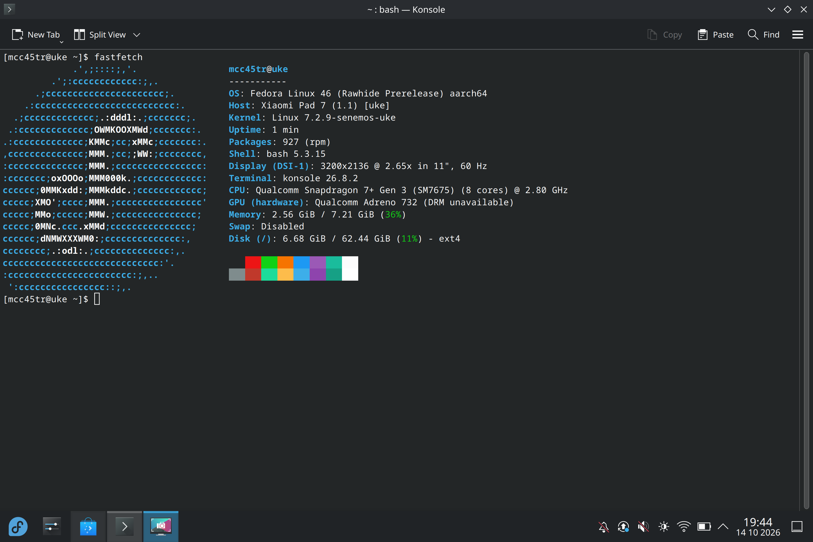

# Uke Linux

Linux for Xiaomi Pad 7 and POCO Pad X1 (`uke`, Snapdragon 7+ Gen 3 / SM7675).

## Status — 14 October 2026

Fedora boots to a local console and the original KDE desktop. Wi-Fi, SSH and
signed DNF updates work. Experimental Freedreno graphics now work in KDE,
Xwayland/OpenGL and a Turnip Vulkan test at 255 MHz. Finger input and ten
simultaneous touch contacts worked in the 14 October tablet test. Bluetooth,
audio and USB host mode do not work yet.

Battery readings and manual backlight control are available. Experimental
sensor tests return acceleration, gyroscope and rear-light readings, but
automatic screen rotation and brightness are not ready.

The boot and graphics trials below use kernel package revision **1.27** in a RAM
boot.
Revision **1.30** has passed signed RPM and module checks; it has not been tested
on the tablet. Normal slot-B startup is still unreliable. Android slot A and a
Linux rollback are retained.

The GPU result uses a RAM candidate and manually loaded matching modules.
Automatic early GPU loading failed and is not ready for unattended boot.
Full GPU frequencies, thermal limits, suspend and sustained workloads still
need testing. The [GPU branch](https://github.com/MCC45TR/senemos-uke-kernel-mainline/pull/29)
remains experimental. Linux 7.2.10 migration is in progress; current tablet
results remain from 7.2.9.

This repository contains the project overview and workspace. Sources are in the
[component repositories](#project-repositories); detailed test records are private.

## Hardware support

**Baseline test environment, 13 October 2026:** POCO Pad X1, 8 GB / 512 GB; Fedora
Rawhide AArch64; Linux `7.2.9-senemos-uke`; stock Android bootloader. The Linux
model label is configured as Xiaomi Pad 7. Other variants remain untested.
The table includes earlier development tests and marks experimental results.

| Status | Meaning |
|---|---|
| 🟢 **Working** | The listed function was used successfully on the tablet. |
| 🟡 **Partial** | Some functions work; limitations are listed. |
| 🔴 **Broken** | The function does not work in this Linux build. |
| ⚪ **Not tested** | No functional test result is available. |
| ⏸️ **Disabled** | Kept off while a known fault is investigated. |

### Boot, processor and storage

| Feature | Status | Test result / remaining work |
|---|---|---|
| Fedora boot | 🟡 **Partial** | Repeated RAM boots reach Fedora and Wi-Fi SSH. Cold boot and normal slot-B startup still need testing. |
| CPU — Snapdragon 7+ Gen 3 (SM7675) | 🟢 **Working** | All eight cores are online. Heavy workloads have not been tested. |
| CPU frequency control | 🟡 **Partial** | Three frequency policies are active: 0.365–1.901, 0.480–2.611 and 0.480–2.803 GHz. Voltage and throttling behavior still need testing. |
| RAM | 🟡 **Partial** | About 7.21 GiB of the installed 8 GB is available. Memory stress and sleep retention have not been tested. |
| UFS storage | 🟢 **Working** | The internal Fedora root supports reads and writes. Long transfers, power loss and resume have not been tested. |
| Linux partition / EXT4 | 🟡 **Partial** | The 64 GiB root mounts by `PARTLABEL=linux`. Filesystem checks pass after orphan repair; power-loss recovery and complete file integrity still need testing. |
| `reboot bootloader` | 🟡 **Partial** | Returns to fastboot. One shutdown took about 106 seconds; reliability still needs work. |
| Normal reboot, recovery command and poweroff | ⚪ **Not tested** | These routes have not completed testing on the current candidate. |
| Project Aloha / UEFI boot | ⚪ **Not tested** | The Uke UEFI port is in development. Current Fedora tests use the Android bootloader. |

### Screen and input

| Feature | Status | Test result / remaining work |
|---|---|---|
| Tablet screen / local TTY | 🟢 **Working** | A local console is visible at 3200×2136 using the bootloader framebuffer. |
| Backlight brightness | 🟡 **Partial** | Manual brightness and off/on control work on both LED banks. Full-range calibration and automatic control still need testing. |
| Screen-off backlight / DPMS | 🟡 **Partial** | One desktop screen-off/on cycle fully disabled the backlight and restored its brightness. Repeated cycles and resume remain untested. |
| Native panel control / refresh switching | 🔴 **Broken** | Linux still relies on the bootloader's fixed display setup. |
| Firmware DRM | 🟡 **Partial** | simpledrm provides the fixed display output while Adreno renders the experimental desktop. Native panel control and refresh switching are incomplete. |
| Original Fedora KDE / Wayland | 🟡 **Partial** | KWin reports Freedreno OpenGL ES 3.2 in the GPU RAM trial. Automatic GPU startup and long-term stability remain unresolved. |
| Manual display rotation | 🟢 **Working** | KScreen rotated the desktop by 90° and restored landscape. Automatic rotation does not work. |
| GPU — Adreno 732 | 🟡 **Partial — experimental** | Native shader/pixel-readback tests pass at 255 MHz. KDE and Xwayland use Freedreno; a 120-frame Turnip Wayland cube passes. Higher frequencies, thermal protection, automatic startup and suspend are incomplete. Mesa currently mislabels this exact chip FD735. |
| Xwayland / OpenGL | 🟡 **Partial — experimental** | A fresh session reports Freedreno and hardware acceleration, with OpenGL 4.6 available. Late GPU loading requires a clean graphical session; broad application testing remains open. |
| Vulkan / Turnip | 🟡 **Partial — experimental** | A bounded Wayland cube completes on the hardware GPU. Vulkan conformance, long workloads and lifecycle tests have not been completed. |
| Touchscreen — Novatek NT36532 | 🟢 **Working** | Finger input and ten simultaneous contacts worked in the 14 October tablet test. Stylus, edge coverage, coordinate transforms and suspend/resume remain untested. |
| Stylus / pen | 🔴 **Broken** | Pen input, pressure and tilt are unavailable. |
| Power / volume buttons | 🟡 **Partial** | Drivers register. Physical key events and navigation still need testing. |
| USB keyboard / mouse | 🔴 **Broken** | The USB mouse dongle was not detected. USB host mode does not work. |
| Pogo keyboard / touchpad | ⚪ **Not tested** | Attachment and input events have not been tested. |

### Networking and USB

| Feature | Status | Test result / remaining work |
|---|---|---|
| Wi-Fi — WCN6750 | 🟢 **Working** | Automatic connection, SSH, DNS and a verified 16 MiB transfer work. Cold boot and resume still need testing. |
| Signed network updates | 🟢 **Working** | Fedora and COPR packages install over Wi-Fi with signature checks. Kernel and boot-image updates require matching files. |
| Bluetooth | 🔴 **Broken** | No controller is available for scanning or pairing. |
| NFC | ⚪ **Not tested** | No controller is exposed. A fitted NFC chip has not been confirmed. |
| USB overall | 🟡 **Partial** | Device mode works with a computer. Host power and role switching do not work yet. |
| USB CDC ACM / serial shell | 🟡 **Partial** | The serial interface registers. Reliable two-way commands still need testing. |
| USB ECM / SSH | 🟢 **Working — manual** | SSH and a verified 16 MiB transfer worked in earlier tests. USB networking is now off by default; development uses Wi-Fi. |
| USB host / accessory power (VBUS) | 🔴 **Broken** | The USB port did not supply power to the ESP32-S3. Host accessories are not usable yet. |
| USB-C switch / role control | 🟡 **Partial** | The switch driver starts and device mode works. Automatic role changes and host power still need work. |
| USB reconnect / driver lifecycle | 🟡 **Partial** | Software reconnect worked. A live battery-driver reload caused a USB fault; the correction and physical cable reconnect still need testing. |
| USB SuperSpeed | ⚪ **Not tested** | No USB 3 accessory transfer has been verified. |
| DisplayPort / USB-C video output | ⚪ **Not tested** | No successful external-display test. |
| USB Ethernet adapters / hubs | ⚪ **Not tested** | No functional adapter or hub test. |

### Sensors

LSM6DSO and SIP1328 return samples in experimental RAM boots using native SSC
tools. Other sensor names come from stock Android and OEM configuration.
Permanent startup and desktop integration are incomplete. OEM calibration is
kept on read-only `persist`; experimental registry writes use a RAM copy.

| Feature | Status | Test result / remaining work |
|---|---|---|
| Sensor DSP / SSC discovery | 🟡 **Partial** | Experimental tests find fifteen endpoints and return orientation through SensorProxy. Permanent startup and restart support are incomplete. |
| Accelerometer — LSM6DSO | 🟡 **Partial** | XYZ samples and stationary SensorProxy orientation are available in bounded tests. Axis alignment, movement tests and automatic desktop rotation are incomplete. |
| Gyroscope — LSM6DSO | 🟡 **Partial** | XYZ samples settle near zero at rest. Rotation, drift and desktop integration still need testing. |
| Magnetometer / compass — QMC630x family | 🔴 **Broken** | No magnetic-field readings or working compass. |
| Front light sensor — STK3BCx family | 🔴 **Broken** | No usable front ambient-light readings. |
| Rear light sensor — SIP1328 | 🟡 **Partial** | Raw channels are readable. Units, response to light, lux conversion and flicker still need testing. |
| Front proximity sensor — STK3BCx family | 🔴 **Broken** | No usable proximity events. |
| SAR / body proximity — SX937x family | 🔴 **Broken** | No usable capacitive proximity readings. |
| Automatic rotation / sensor fusion | 🔴 **Broken** | Motion samples exist, but automatic desktop rotation does not work. |
| Automatic brightness | 🔴 **Broken** | No working front-light or desktop lux interface. Manual backlight control is available. |
| Hall / cover detection | ⚪ **Not tested** | The DSP lists a hall service. Cover events and Linux integration have not been tested. |
| Temperature sensors | 🟡 **Partial** | Thirty-seven thermal zones and 38 hwmon channels are readable, including battery and Wi-Fi. Channels overlap; accuracy and protective actions remain untested. |

### Audio and media

| Feature | Status | Test result / remaining work |
|---|---|---|
| Internal speakers | 🔴 **Broken** | No usable ALSA playback route. |
| Microphones | 🔴 **Broken** | No usable ALSA recording route. |
| USB / Bluetooth audio | ⚪ **Not tested** | No playback or recording test. Bluetooth itself does not work. |
| Front camera | ⚪ **Not tested** | No verified capture pipeline or frame. |
| Rear camera | ⚪ **Not tested** | No verified capture pipeline or frame. |
| Hardware video decoding / encoding | ⚪ **Not tested** | No verified hardware codec workload. |

### Power, time and platform services

| Feature | Status | Test result / remaining work |
|---|---|---|
| Battery percentage / voltage / temperature | 🟡 **Partial** | Real readings start automatically in a fresh RAM boot. Repeated cold boots and long-term readings still need testing. |
| Battery current / power / charging indication | 🟡 **Partial** | Current is readable. Current direction and charge-counter units need the prepared driver correction. A Charging label alone does not prove battery gain. |
| Charging from computer USB | 🟡 **Partial** | A manual 500 mA limit is accepted. Screen-off samples indicate charging, but screen-on load may exceed supply. Automatic limits and sustained capacity gain still need testing. |
| USB Power Delivery / fast charging | ⚪ **Not tested** | Higher-power charging and protocol/protection behavior have not been tested. |
| Plasma battery indicator | 🟡 **Partial** | The battery icon and readings were observed through UPower. Startup and current/counter interpretation still need work. |
| Thermal protection / throttling | ⚪ **Not tested** | Throttling and protective shutdown have not been verified. |
| Display-only soft sleep | 🟡 **Partial** | One screen-off/on cycle turned off and restored the backlight. This does not suspend the system. |
| Suspend-to-idle / s2idle | ⏸️ **Disabled** | Sleep remains disabled. The brief black-screen interval did not confirm suspend entry. |
| Deep suspend | ⚪ **Not tested** | Advertised by the kernel; actual sleep and resume have not been verified. |
| Power-key IRQ wake | ⚪ **Not tested** | The input and wake flag exist. Wake from actual sleep has not been tested. |
| USB cable wake | 🔴 **Broken** | Required USB wake interrupts are missing from the current device tree. |
| USB keyboard / mouse wake | 🔴 **Broken** | USB host accessories do not work yet. |
| RTC / persistent clock | 🟡 **Partial** | Network time works. The RTC supplies an incorrect startup time. |
| Watchdog | 🟡 **Partial** | The driver starts. Recovery behavior has not been tested. |
| PMIC / regulators | 🟡 **Partial** | Storage and USB have enough working resources. Other PMIC probes still fail. |
| DMA / IOMMU resources | 🟡 **Partial** | Storage, USB and Wi-Fi paths work. GPU and other clients need integration and testing. |
| Interconnect / platform power control | 🟡 **Partial** | Basic root and USB operations work. Provider errors and power/performance behavior remain unresolved. |
| DSPs — ADSP / CDSP / QSH | 🟡 **Partial** | ADSP provides charger services; experimental tools read motion and rear-light data. Audio, other DSPs and restart reliability remain unresolved. SLIMbus and automatic DSP recovery are disabled. |
| FastRPC | 🟡 **Partial** | Two ADSP contexts serve the experimental sensor registry. General DSP compute and permanent startup are untested. |
| CoreSight tracing | ⏸️ **Disabled** | Autoload is blocked after earlier resets. The cause still needs investigation. |

The current boot handoff is **EL1**. EL2/KVM work remains on a separate
experimental branch. Reading a temperature or installing an RPM does not
establish working thermal protection, charging or boot reliability.

## Project repositories

| Repository | Purpose |
|---|---|
| [Senemos kernel](https://github.com/MCC45TR/senemos-uke-kernel-mainline) | Kernel, device trees and Fedora RPMs |
| [Hardware support](https://github.com/MCC45TR/uke-linux-hardware-support) | Device integration and platform packages |
| [Fedora builder](https://github.com/MCC45TR/uke-fedora-builder) | Image recipes and validation tools |
| [Linux images](https://github.com/MCC45TR/uke-linux-images) | Image releases and checksums |
| [OrangeFox Recovery](https://github.com/MCC45TR/orangefox_device_xiaomi_uke) | Recovery and storage management |
| [Project Aloha](https://github.com/MCC45TR/uke-project-aloha) | UEFI port |
| [Engineering records](https://github.com/MCC45TR/uke-linux-docs) | Private reports, lessons and risk records; access required |

## Downloads and development

- [Development RPMs on COPR](https://copr.fedorainfracloud.org/coprs/mcc45tr/uke-linux-test/)
- [Fedora image releases](https://github.com/MCC45TR/uke-linux-images/releases)
- [Experimental recovery releases](https://github.com/MCC45TR/orangefox_device_xiaomi_uke/releases)

The published Core and KDE images are prebuild tests. Their exact root filesystems
have host/VM checks but have not been booted on this tablet. Tablet results above
come from a separate development installation. DNF does not flash Android
partitions or select a boot slot.

KDE applications come from Fedora; no Uke clones or rebuilds are used. The current
development KDE installation includes Python dependencies and does not meet the
project's Python-free target policy. A compliant KDE release remains blocked.
Core, early initramfs and new project device tools are checked separately.

```sh
git clone --recurse-submodules https://github.com/MCC45TR/uke-linux.git
cd uke-linux
./senemos-uke-kernel/senemos.sh --build 7.2.9 --distro=fedora --test
./ukelinux.sh --build core --distro=fedora --test
./ukelinux.sh --build boot-pair --distro=fedora --help
```

`senemos.sh` builds the kernel. `ukelinux.sh` builds images. The stock-bootloader
pair contains `fedora_boot.img` for `boot_b` and `system.img` for a separately
prepared GPT partition named `linux` (at least 3 GiB). It uses `PARTLABEL=linux`,
not a fixed UUID. The older `--build boot` profile contains only a debug initramfs.
These build commands do not create partitions or flash the tablet.

Run `./ukelinux.sh --check-device --pair DELIVERY_DIRECTORY` for read-only
file and device checks before a trial. See the [image guide](https://github.com/MCC45TR/uke-fedora-builder/blob/main/docs/IMAGES.md)
and [boot-pair instructions](https://github.com/MCC45TR/uke-linux-docs/blob/main/docs/testing/FEDORA-BOOT-PAIR.md)
(private) for requirements and rollback.

This is an independent community project. It is not an official Fedora, Xiaomi,
POCO or Qualcomm product. Original files use MIT; components retain their own licenses.

Documentation follows the [report style](CONTRIBUTING.md).
