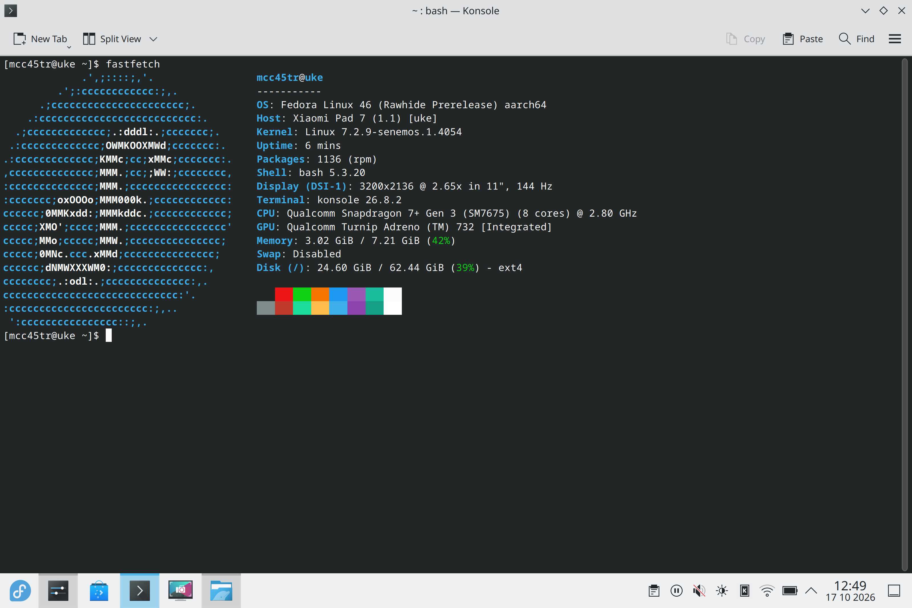

# Uke Linux

Linux for Xiaomi Pad 7 and POCO Pad X1 (`uke`, Snapdragon 7+ Gen 3 / SM7675).

## Fedora Rawhide Alpha 1

**Experimental alpha — not suitable for daily use.** Boot reliability, display
artifacts, power management and several hardware functions remain unresolved.

[Release files and checksums](https://github.com/MCC45TR/uke-linux/releases/tag/fedora-rawhide-alpha-1):

| File | Purpose |
|---|---|
| `fedora-rawhide-uke-system-alpha-1.img` | Fedora Rawhide root filesystem |
| `fedora-linux-uke-senemos-729-boot-lp.img` | Boot image targeting `PARTLABEL=linux` |
| `fedora-linux-uke-senemos-729-kernel-up.img` | Experimental boot image targeting `PARTLABEL=userdata`; not tested on the tablet |

The software baseline is normal Linux 7.2.9 revision 1.39. Both public boot
variants and the exported root filesystem are rebuilt and have not been booted
on the tablet. The hardware results below refer to the separate development
installation. Installation instructions will follow.
See the [short bug-report guide](CONTRIBUTING.md) before opening an issue.

OEM firmware and device calibration files are not distributed. The public image
does not include their provisioning workflow, so hardware that requires those
files cannot be assumed to work. The status table describes the separately
provisioned development system. Using `userdata` for Fedora replaces Android
user data; this variant is not an Android data-preserving dual-boot route.

## Status — 17 October 2026

The development installation now reaches the original Fedora KDE desktop
through the **native DPU/DSI display driver at 3200×2136**. Linux
`7.2.9-senemos.1.4054` starts from the installed slot B image and uses
`msm-kmsdrmfb`, rather than the bootloader framebuffer. This is the first
tested seven-rate native-display build; repeated starts and display lifecycle tests
remain open. The released Alpha 1 images still use revision 1.39 and do not
include this development result.

Manual OEM-mapped brightness adjustment is smooth. Power and volume buttons,
single-finger input and multitouch work; touchscreen suspend/resume remains
untested. All seven OEM refresh rates — 30, 48, 50, 60, 90, 120 and
144 Hz — work in KDE. Nine measured transitions retained the panel reset count,
touch process and input device. Direct testing found no visible blanking or
interruption of single-finger and multitouch input. Adaptive sync is not available.

Wi-Fi, SSH, signed DNF updates and battery readings are available. Earlier
Freedreno tests exercised KDE, Xwayland/OpenGL and Turnip Vulkan at 255 MHz;
full GPU workloads and thermal limits remain unqualified. Experimental sensor
tests return acceleration, gyroscope and rear-light readings, but automatic
rotation and automatic brightness are not ready. Bluetooth and audio remain
unavailable. USB data-role and source/sink power-role management need work, and closing the magnetic
cover does not turn off the display. Android slot A and the Linux rollback are
preserved.

Linux 7.2.10 remains a separate candidate; development continues on 7.2.9.

On 17 October, [COPR build 11163806](https://copr.fedorainfracloud.org/coprs/build/11163806)
built the consolidated mainline display source as 7.2.9-1.4054.3 for Rawhide
AArch64. The separate native package has been retired. COPR supplies a raw Image,
modules and DTBs; its reproducible boot-container integration is still pending.
The tested tablet uses the separately matched `.4054` development boot bundle.

This repository contains the project overview and workspace. Sources are in the
[component repositories](#project-repositories); detailed test records are private.

## Hardware support

**Reviewed 17 October 2026:** POCO Pad X1, 8 GB / 512 GB; Fedora Rawhide AArch64;
stock Android bootloader. Native display was observed on Linux
`7.2.9-senemos.1.4054`; earlier subsystem tests are identified below. The Linux
model label is Xiaomi Pad 7. Other variants remain untested. These are
development-system results, not acceptance of the downloadable Alpha 1 images.

| Status | Meaning |
|---|---|
| 🟢 **Working** | The listed function was used successfully on the tablet. |
| 🟡 **Partial** | Some functions work; limitations are listed. |
| 🔴 **Broken** | The function does not work in this Linux build. |
| ⚪ **Not tested** | No functional test result is available. |
| ⏸️ **Disabled** | Kept off while a known fault is investigated. |

### Boot, processor and storage

| Feature | Status | Test result / remaining work |
|---|---|---|
| Fedora boot | 🟡 **Partial** | The installed `.4054` slot B image reached the native-display KDE desktop on 17 October. Repeated cold boots and failure recovery remain under test. |
| CPU — Snapdragon 7+ Gen 3 (SM7675) | 🟢 **Working** | All eight cores are online. Heavy workloads have not been tested. |
| CPU frequency control | 🟡 **Partial** | Three schedutil policies expose 0.365–1.901, 0.480–2.611 and 0.480–2.803 GHz; frequencies change during operation. Voltage and throttling behavior still need testing. |
| RAM | 🟡 **Partial** | About 7.21 GiB of the installed 8 GB is available. Memory stress and sleep retention have not been tested. |
| UFS storage | 🟢 **Working** | The internal Fedora root supports reads and writes. Long transfers, power loss and resume have not been tested. |
| Linux partition / EXT4 | 🟡 **Partial** | The 64 GiB root mounts by `PARTLABEL=linux`. Filesystem checks pass after orphan repair; power-loss recovery and complete file integrity still need testing. |
| `reboot bootloader` | 🟡 **Partial** | Returns to fastboot. One shutdown took about 106 seconds; reliability still needs work. |
| Normal reboot, recovery command and poweroff | ⚪ **Not tested** | These routes have not completed testing on the current candidate. |
| Project Aloha / UEFI boot | ⚪ **Not tested** | The Uke UEFI port is in development. Current Fedora tests use the Android bootloader. |

### Screen and input

| Feature | Status | Test result / remaining work |
|---|---|---|
| Tablet screen / local TTY | 🟢 **Working** | A local console and KDE desktop are visible at 3200×2136. The 17 October native-display boot uses MSM DRM scanout. |
| Manual backlight brightness | 🟢 **Working** | Smooth adjustment was confirmed on 17 October. Both banks use the exact OEM normal-mode mapping through the standard non-linear backlight interface. Active zero requests retain a visible minimum. Optical calibration and automatic control are separate. |
| Screen-off backlight / DPMS | 🟡 **Partial** | One desktop screen-off/on cycle fully disabled the backlight and restored its brightness. Repeated cycles and resume remain untested. |
| Native DPU / DSI / DSC display | 🟢 **Working** | The `.4054` persistent boot displays KDE through DSI-1 and `msm-kmsdrmfb` at all seven OEM rates. Repeated starts, blanking and suspend remain unqualified. |
| Refresh-rate switching | 🟢 **Working** | KDE exposes 30/48/50/60/90/120/144 Hz. Nine measured transitions passed on 17 October without panel reset, visible blanking or interrupted touch. Long-run and suspend tests remain open. |
| Adaptive sync / dynamic refresh | 🔴 **Broken** | No qualified VRR implementation. Discrete OEM modes do not establish adaptive-sync support. |
| Firmware DRM fallback | 🟡 **Partial** | Revision 1.39 uses simpledrm and the bootloader framebuffer. This older path remains separate from the `.4050` native-display candidate. |
| Original Fedora KDE / Wayland | 🟡 **Partial** | KDE is visible through native scanout on `.4054`. Earlier revision 1.39 starts KWin with Adreno 732 rendering. Original Fedora applications include Discover, KWrite, Chromium and Dolphin administration support. Sustained graphics and session stability remain under test. |
| Manual display rotation | 🟢 **Working** | KScreen rotated the desktop by 90° and restored landscape. Automatic rotation does not work. |
| GPU — Adreno 732 | 🟡 **Partial — experimental** | Automatic hardware rendering reports FD732. Earlier shader/pixel-readback and bounded Vulkan tests passed at 255 MHz. The driver exposes 255–950 MHz; sustained load, thermal behavior and suspend are unqualified. |
| Xwayland / OpenGL | 🟡 **Partial — experimental** | A fresh session reports Freedreno and hardware acceleration, with OpenGL 4.6 available. Late GPU loading requires a clean graphical session; broad application testing remains open. |
| Vulkan / Turnip | 🟡 **Partial — experimental** | A bounded Wayland cube completes on the hardware GPU. Vulkan conformance, long workloads and lifecycle tests have not been completed. |
| Touchscreen — Novatek NT36532 | 🟢 **Working** | Single-finger input and multitouch remain usable across all seven refresh rates, confirmed on 17 October. Ten simultaneous contacts worked in the 14 October test. Input starts automatically; suspend/resume remains to be validated. Stylus support is listed separately. |
| Stylus / pen | 🔴 **Broken** | Pen input, pressure and tilt are unavailable. |
| Power / volume buttons | 🟢 **Working** | All power and volume buttons work during normal Fedora use, confirmed on 14 and 17 October. Wake from actual suspend is listed separately. |
| USB keyboard / mouse | 🔴 **Broken** | The USB mouse dongle was not detected. USB host mode does not work. |
| Pogo keyboard / touchpad | ⚪ **Not tested** | Attachment and input events have not been tested. |

### Networking and USB

| Feature | Status | Test result / remaining work |
|---|---|---|
| Wi-Fi — WCN6750 | 🟢 **Working** | Automatic connection, SSH, DNS and a verified 16 MiB transfer work. The protected factory-data reader supplies the device's own WLAN address across restarts. Broader cold-boot and resume testing remains open. |
| Signed network updates | 🟢 **Working** | Fedora and COPR packages install over Wi-Fi with signature checks. Kernel and boot-image updates require matching files. |
| Bluetooth | 🔴 **Broken** | No controller is available for scanning or pairing. |
| NFC | ⚪ **Not tested** | No controller is exposed. A fitted NFC chip has not been confirmed. |
| USB overall | 🟡 **Partial** | Device mode works with a computer. Automatic host/device data roles and source/sink power roles are incomplete; accessories are not reliable. |
| USB CDC ACM / serial shell | 🟡 **Partial** | Bidirectional development commands work through normal boot and switch-root. Physical reconnect, suspend and role-change reliability remain unqualified. |
| USB ECM / SSH | 🟢 **Working — manual** | SSH and a verified 16 MiB transfer worked in earlier tests. USB networking is now off by default; development uses Wi-Fi. |
| USB host / accessory power (VBUS) | 🔴 **Broken** | The USB port did not supply power to the ESP32-S3. Host accessories are not usable yet. |
| USB-C switch / role control | 🟡 **Partial** | The switch driver starts and device mode works. Data-role and source/sink power-role selection are not yet correct across connections; role changes and accessory power need work. |
| USB reconnect / driver lifecycle | 🟡 **Partial** | Software reconnect worked. A live battery-driver reload caused a USB fault; the correction and physical cable reconnect still need testing. |
| USB SuperSpeed | ⚪ **Not tested** | No USB 3 accessory transfer has been verified. |
| DisplayPort / USB-C video output | ⚪ **Not tested** | No successful external-display test. |
| USB Ethernet adapters / hubs | ⚪ **Not tested** | No functional adapter or hub test. |

### Sensors

LSM6DSO and SIP1328 return samples in experimental RAM boots using native SSC
tools. Other sensor names come from stock Android and OEM configuration.
Permanent startup and desktop integration are incomplete. OEM calibration is
kept on read-only `persist`; experimental registry writes use a RAM copy.

| Feature | Status | Test result / remaining work |
|---|---|---|
| Sensor DSP / SSC discovery | 🟡 **Partial** | Experimental tests find fifteen endpoints and return orientation through SensorProxy. Permanent startup and restart support are incomplete. |
| Accelerometer — LSM6DSO | 🟡 **Partial** | XYZ samples and stationary SensorProxy orientation are available in bounded tests. Axis alignment, movement tests and automatic desktop rotation are incomplete. |
| Gyroscope — LSM6DSO | 🟡 **Partial** | XYZ samples settle near zero at rest. Rotation, drift and desktop integration still need testing. |
| Magnetometer / compass — QMC630x family | 🔴 **Broken** | No magnetic-field readings or working compass. |
| Front light sensor — STK3BCx family | 🔴 **Broken** | No usable front ambient-light readings. |
| Rear light sensor — SIP1328 | 🟡 **Partial** | Raw channels are readable. Units, response to light, lux conversion and flicker still need testing. |
| Front proximity sensor — STK3BCx family | 🔴 **Broken** | No usable proximity events. |
| SAR / body proximity — SX937x family | 🔴 **Broken** | No usable capacitive proximity readings. |
| Automatic rotation / sensor fusion | 🔴 **Broken** | Motion samples exist, but automatic desktop rotation does not work. |
| Automatic brightness | 🔴 **Broken** | No working front-light or desktop lux interface. Manual backlight control is available. |
| Magnetic cover / lid detection | 🔴 **Broken** | Closing the stock magnetic cover did not blank the display in the 17 October test. The DSP lists a hall service, but physical sensor events and Linux lid integration remain unverified. |
| Temperature sensors | 🟡 **Partial** | Thirty-seven thermal zones and 38 hwmon channels are readable, including battery and Wi-Fi. Channels overlap; accuracy and protective actions remain untested. |

### Audio and media

| Feature | Status | Test result / remaining work |
|---|---|---|
| Internal speakers | 🔴 **Broken** | No usable ALSA playback route. |
| Microphones | 🔴 **Broken** | No usable ALSA recording route. |
| USB / Bluetooth audio | ⚪ **Not tested** | No playback or recording test. Bluetooth itself does not work. |
| Front camera | ⚪ **Not tested** | No verified capture pipeline or frame. |
| Rear camera | ⚪ **Not tested** | No verified capture pipeline or frame. |
| Hardware video decoding / encoding | ⚪ **Not tested** | No verified hardware codec workload. |

### Power, time and platform services

| Feature | Status | Test result / remaining work |
|---|---|---|
| Battery percentage / voltage / temperature | 🟡 **Partial** | Readings start automatically on normal slot-B boots. Long-term accuracy and all battery states still need testing. |
| Battery current / power / charging indication | 🟡 **Partial** | Signed current and charge-counter readings reach the standard power-supply/UPower interfaces. External power can be present while the battery discharges; a Charging flag alone does not prove energy gain. |
| Charging from computer USB | 🟡 **Partial** | Revision 1.39 automatically admits the enumerated 500 mA budget; measured input is about 450 mA. Active-system load can exceed this supply, and a three-minute native diagnostic trial lost battery charge. Sustained net charging remains unqualified. |
| USB Power Delivery / fast charging | ⚪ **Not tested** | Higher-power charging and protocol/protection behavior have not been tested. |
| Plasma battery indicator | 🟡 **Partial** | The battery icon and readings were observed through UPower. Startup and current/counter interpretation still need work. |
| Desktop power profiles | 🔴 **Broken** | The original power-profiles-daemon has a placeholder backend. KDE correctly hides the ineffective choices; a real CPU/GPU policy backend is still needed. |
| Thermal protection / throttling | ⚪ **Not tested** | Throttling and protective shutdown have not been verified. |
| Display-only soft sleep | 🟡 **Partial** | One screen-off/on cycle turned off and restored the backlight. This does not suspend the system. |
| Suspend-to-idle / s2idle | ⏸️ **Disabled** | Sleep remains disabled. The brief black-screen interval did not confirm suspend entry. |
| Deep suspend | ⚪ **Not tested** | Advertised by the kernel; actual sleep and resume have not been verified. |
| Power-key IRQ wake | ⚪ **Not tested** | The input and wake flag exist. Wake from actual sleep has not been tested. |
| USB cable wake | 🔴 **Broken** | Required USB wake interrupts are missing from the current device tree. |
| USB keyboard / mouse wake | 🔴 **Broken** | USB host accessories do not work yet. |
| RTC / persistent clock | 🟡 **Partial** | Network time works. The RTC supplies an incorrect startup time. |
| Watchdog | 🟡 **Partial** | The driver starts. Recovery behavior has not been tested. |
| PMIC / regulators | 🟡 **Partial** | Storage and USB have enough working resources. Other PMIC probes still fail. |
| DMA / IOMMU resources | 🟡 **Partial** | Storage, USB and Wi-Fi paths work. GPU and other clients need integration and testing. |
| Interconnect / platform power control | 🟡 **Partial** | Basic root and USB operations work. Provider errors and power/performance behavior remain unresolved. |
| DSPs — ADSP / CDSP / QSH | 🟡 **Partial** | ADSP provides charger services; experimental tools read motion and rear-light data. Audio, other DSPs and restart reliability remain unresolved. SLIMbus and automatic DSP recovery are disabled. |
| FastRPC | 🟡 **Partial** | Two ADSP contexts serve the experimental sensor registry. General DSP compute and permanent startup are untested. |
| CoreSight tracing | ⏸️ **Disabled** | Autoload is blocked after earlier resets. The cause still needs investigation. |

The current boot handoff is **EL1**. EL2/KVM work remains on a separate
experimental branch. Reading a temperature or installing an RPM does not
establish working thermal protection, charging or boot reliability.

## Project repositories

| Repository | Purpose |
|---|---|
| [Senemos kernel](https://github.com/MCC45TR/senemos-uke-kernel-mainline) | Kernel, device trees and Fedora RPMs |
| [Hardware support](https://github.com/MCC45TR/uke-linux-hardware-support) | Device integration and platform packages |
| [Fedora builder](https://github.com/MCC45TR/uke-fedora-builder) | Image recipes and validation tools |
| [Linux images](https://github.com/MCC45TR/uke-linux-images) | Image releases and checksums |
| [OrangeFox Recovery](https://github.com/MCC45TR/orangefox_device_xiaomi_uke) | Recovery and storage management |
| [Project Aloha](https://github.com/MCC45TR/uke-project-aloha) | UEFI port |
| [Engineering records](https://github.com/MCC45TR/uke-linux-docs) | Private reports, lessons and risk records; access required |

## Downloads and development

- [Development RPMs on COPR](https://copr.fedorainfracloud.org/coprs/mcc45tr/uke-linux-test/)
- [Fedora Rawhide Alpha 1](https://github.com/MCC45TR/uke-linux/releases/tag/fedora-rawhide-alpha-1)
- [Fedora image releases](https://github.com/MCC45TR/uke-linux-images/releases)
- [Experimental recovery releases](https://github.com/MCC45TR/orangefox_device_xiaomi_uke/releases)

The earlier Core and KDE images are prebuild tests. Their exact root filesystems
have host/VM checks but have not been booted on this tablet. Tablet results above
come from a separate development installation. DNF does not flash Android
partitions or select a boot slot.

KDE applications come from Fedora; no Uke clones or rebuilds are used. Unmodified
Fedora desktop packages may retain their original Python dependencies. This
exception does not cover project tools, recovery or initramfs payloads.

```sh
git clone --recurse-submodules https://github.com/MCC45TR/uke-linux.git
cd uke-linux
./senemos-uke-kernel/senemos.sh --build 7.2.9 --distro=fedora --test
./ukelinux.sh --build core --distro=fedora --test
./ukelinux.sh --build boot-pair --distro=fedora --help
```

`senemos.sh` builds the kernel. `ukelinux.sh` builds images. The stock-bootloader
pair contains `fedora_boot.img` for `boot_b` and `system.img` for a separately
prepared GPT partition named `linux` (at least 3 GiB). It uses `PARTLABEL=linux`,
not a fixed UUID. The older `--build boot` profile contains only a debug initramfs.
These build commands do not create partitions or flash the tablet.

Run `./ukelinux.sh --check-device --pair DELIVERY_DIRECTORY` for read-only
file and device checks before a trial. See the [image guide](https://github.com/MCC45TR/uke-fedora-builder/blob/main/docs/IMAGES.md)
and [boot-pair instructions](https://github.com/MCC45TR/uke-linux-docs/blob/main/docs/testing/FEDORA-BOOT-PAIR.md)
(private) for requirements and rollback.

This is an independent community project. It is not an official Fedora, Xiaomi,
POCO or Qualcomm product. Original files use MIT; components retain their own licenses.

Documentation follows the [report style](CONTRIBUTING.md).
