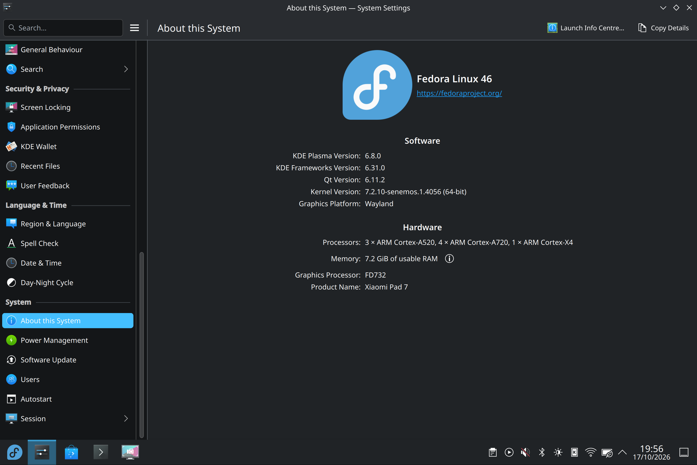
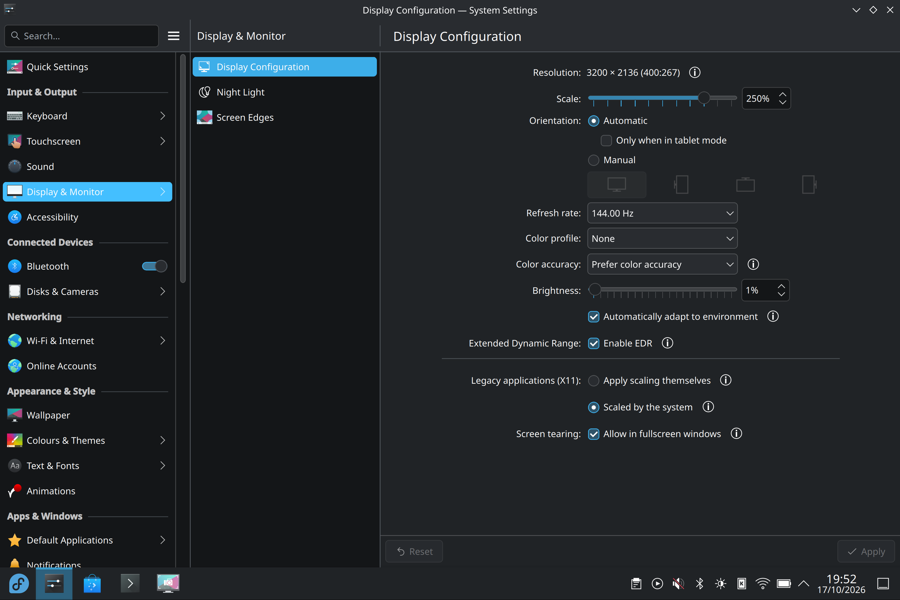
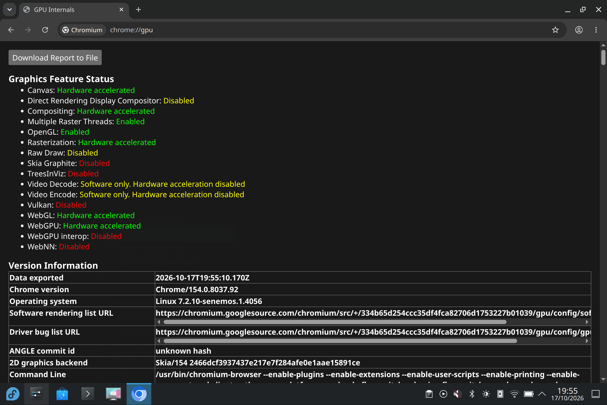

# Fedora KDE screenshot gallery

Fedora Rawhide with KDE Plasma on Uke. Select an image to open its full-resolution file.

[Project overview and hardware status](../../README.md)

## Desktop reference

## Desktop — 17 October 2026

## Fastfetch in Konsole

## System information

## Display settings

## Chromium graphics information

